## 一、人体内环境的稳态

### 1. 细胞生活的环境

#### 1.1 生物生存在环境中

1. 血细胞生活在血浆中，草履虫生活在外界水环境中.

二者都生活在液体环境中，但**血细胞生活在血浆中，并不直接与外界环境进行物质交换，而草履虫生活在外界环境，直接与外界环境进行物质交换**.

#### 1.2 血浆、血液与血清

- 血浆：血液**加入抗凝剂**后静置一段时间，上层的**淡黄色液体**；
- 血清：血液**凝固后上层淡黄色液体**，与血浆相比**不含纤维蛋白原**.
- 血液凝固过程（图）

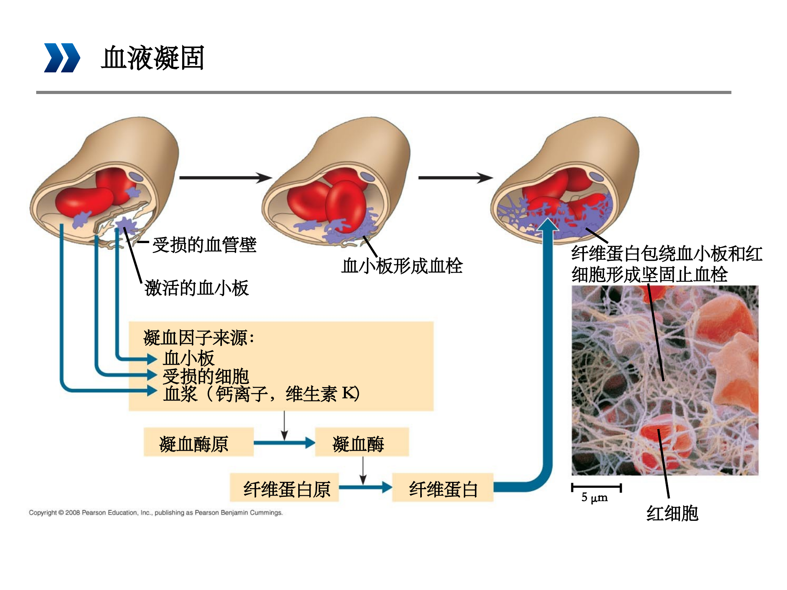

- 血液组成（图）

#### 1.3 体内细胞生活在细胞外液/内环境中

1. 体液的概念：人体内各种以水为基础的液体

体液包括：血浆、组织液、淋巴液

其中，组织液在细胞间隙间；淋巴液位于淋巴管内.

细胞外液也就是内环境，两个说法的区别只在于视角是细胞还是人体.

人体的体液中，细胞外液占三分之一、而细胞内液占三分之二. 对这几种液体排序有：细胞内液>组织液>血浆>淋巴液.

- 汗液、尿液、消化液、泪液、唾液属于体液吗？**不**. 膀胱腔、消化道、口腔、呼吸道、肺泡腔与外界环境相通. 因此汗液、尿液、唾液等不属于体液，属于**体内的外界环境**.

该部分也有整理的（图）.

> **题**：练习：写出对应的体内各种细胞生活的内环境.
>
> 血细胞－？
> **解**：血浆
>
> 组织细胞－？
> **解**：组织液
>
> 淋巴细胞、吞噬细胞－？
> **解**：淋巴液
>
> 毛细血管壁细胞—？
> **解**：血液，组织液
>
> 毛细淋巴管壁细胞—？
> **解**：组织液，淋巴液
>
> 口腔上皮细胞、皮肤细胞—？
> **解**：组织液
>

#### 1.4 细胞外液间的相互转化

1. 转化方向与比例（图）

2. 微循环（图）

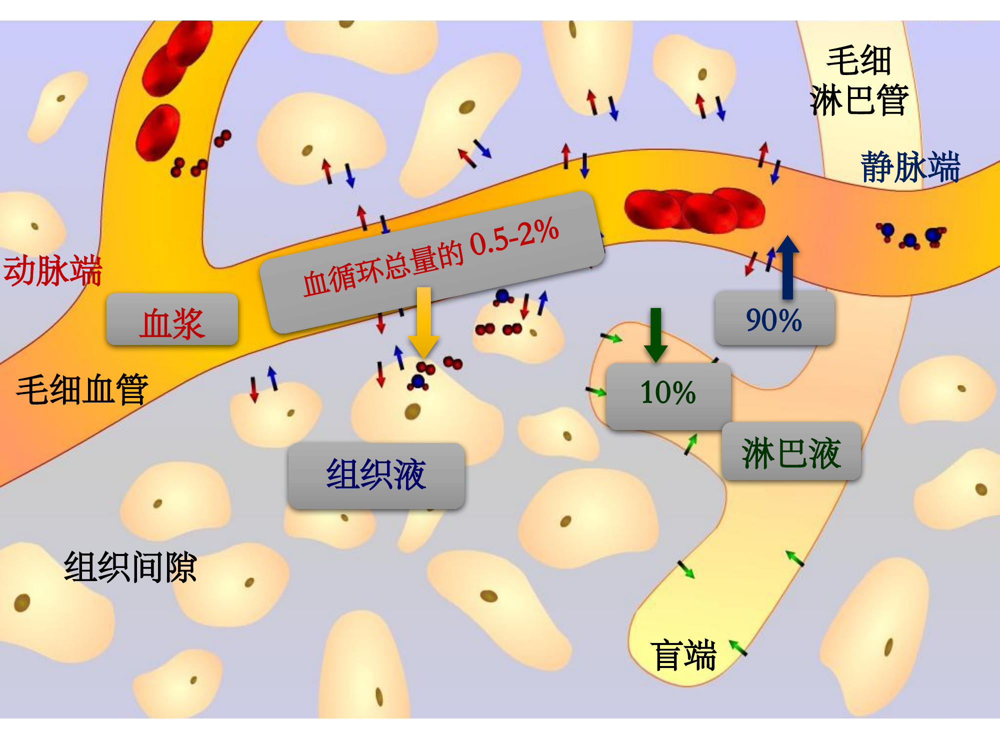

毛细血管特点：1. 分布广泛；2. 管壁薄，单层细胞；3. 管径小，红细胞单行通过；4. 血流速度最慢.

3. 血压的组成

- 毛细血管血压：血液流动产生的压力，由流速决定.
- 血浆胶体渗透压：血浆的蛋白质产生的向血管内“吸引物质”所产生的压力，对动静脉相同，是**负值**.
- 组织液胶体渗透压：组织液的蛋白质产生的向血管外“吸引物质”所产生的压力，对动静脉相同，是**正值**.
- 组织液静水压：组织液流动在血管上产生的压力，对动静脉相同.

将四者相加，得到有效滤过压 $+13$ 和 $-2$，而这决定了动脉与静脉的血液流动方向.

而为了让体液的转换正常进行，大小上，**毛细血管动脉端压力>组织液压力>毛细淋巴管压力>静脉压力**.

上述的水压，正方向向血管外，负方向向血管内.

4. 淋巴循环：相对独立于机体其他系统的一个管网状结构.

循环过程（图）

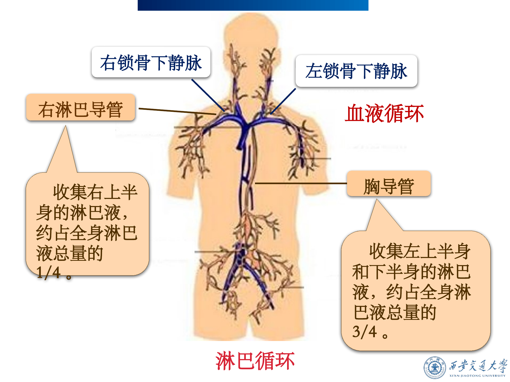

淋巴的功能：**组织液回流**的通道，**免疫和防御**，**脂类**物质代谢过程中的输送管道（如小肠就可将营养直接吸收进淋巴管）

淋巴回流的意义：回收血浆丧失的蛋白质，调节血浆、组织液之间的液体平衡，免疫和防御，运输脂类物质代谢产物

5. 组织液：

影响组织液生成的因素：（1）**有效滤过压**；（2）毛细血管**通透性**；（3）静脉和淋巴回流等.

#### 1.5 人体内环境的概念

1. 人体内环境是指由细胞外液（血浆、组织液和淋巴液）构成的液体环境.

2. 血浆的化学组成

分类方式①：
- 无机物：水，无机盐
- 有机物：糖，蛋白质，脂类

分类方式②：
- 营养物质：水，无机盐，葡萄糖，蛋白质，甘油三酯等
- 代谢废物：尿素，尿酸，肌酐，$\text{CO}_2$.

还有激素，维生素，$\text{O}_2$ 等.

包含的最主要的离子是 $\text{Na}^+,\text{Cl}^-$.

血浆成分饼图（图）

3. 血浆蛋白主要为**清蛋白（又名白蛋白，最主要的蛋白质，维持人体运转）**，**球蛋白（免疫，抗体）**和**纤维蛋白原（凝血和止血）**

清蛋白作用：

- ①维持血浆胶体渗透压的恒定
- ②非专一性运输蛋白，能与体内许多难溶性的小分子有机物和无机离子可逆地结合形成易溶性的复合物
- ③保证细胞内液与细胞外液间的交流
- ④对球蛋白起到一种胶体保护的稳定作用
- ⑤人体内一种重要的营养物质
- ⑥具有黏性、胶质性，可自动与重金属离子结合，起到解毒的作用

#### 1.6 内环境的理化性质

1. 渗透压的形成：用半透膜把两种不同浓度的溶液隔开时发生渗透现象，到达平衡时半透膜两侧溶液产生的位能差（多的向少的一方走）.

2. 渗透是水的被动运输

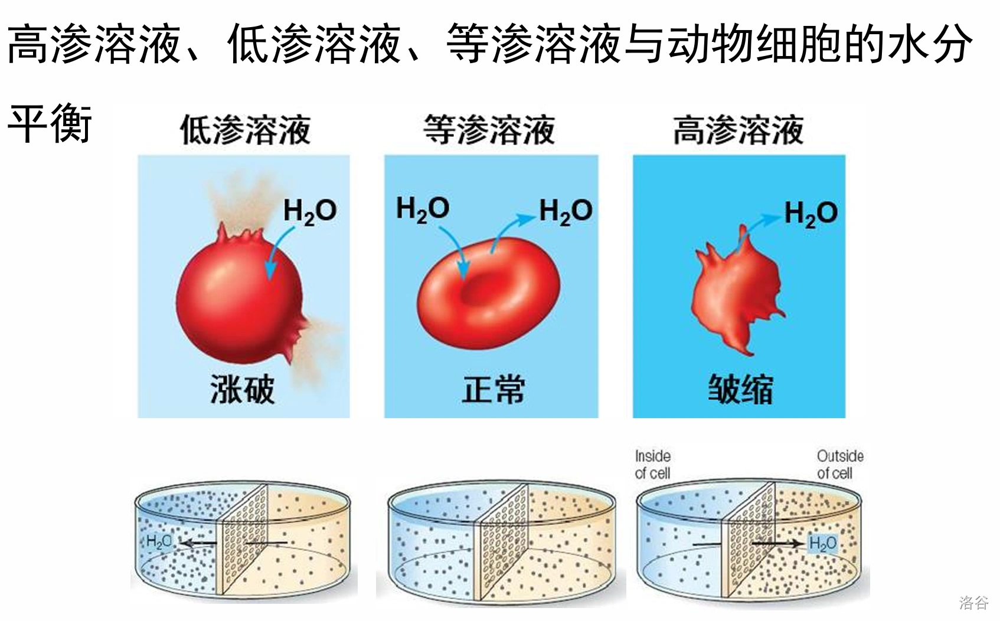

3. 渗透压的概念：溶液中**溶质微粒**对**水**的吸引力.（回想一下血压中说过的两个渗透压的形成过程）

- 单位体积溶液中溶质微粒越多 $\to$ 溶液浓度越高 $\to$ 对水的吸引力越大 $\to$ 溶液渗透压越高
- 细胞外液渗透压 90%以上来源于 $\text{Na}^+,\text{Cl}^-$.
- $37\,\text{℃}$ 时，人的血浆渗透压=细胞内液渗透压=$770\,\text{kPa}$
=淋巴液渗透压=组织液渗透压，物质能平衡地进出细胞.

4. 渗透压分类（图）

5. 血浆酸碱度

- 维持在 $7.35\sim7.45$ 之间
- 通过碳酸与磷酸的**缓冲对转化**调节（原理就是酸的电离与水解）

**总结：内环境的理化性质：体温 $37\,\text{℃}$ 左右，渗透压 $770\,\text{kPa}$，$\text{pH}=7.35\sim7.45$.**

#### 1.7 细胞与外界交流

1. 呼吸系统（同初中背的，动静脉血与顺序）

2. 消化系统：小肠绒毛吸收营养成分

3. 循环系统

4. 泌尿系统

5. 细胞通过内环境与外界进行物质交换（图）

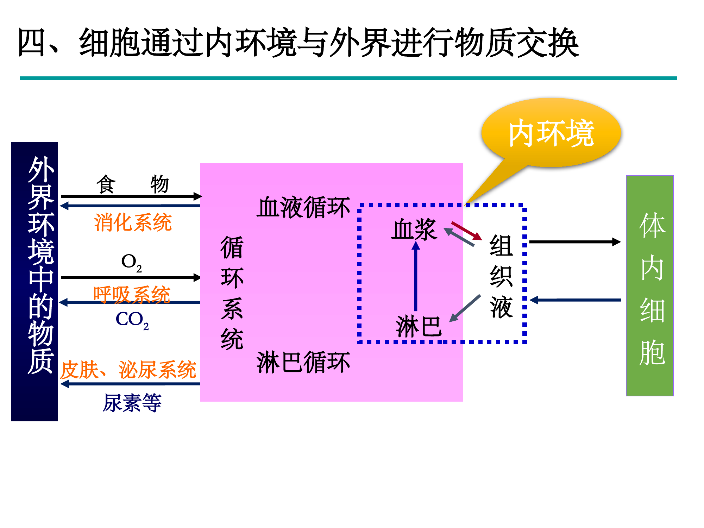

### 2. 内环境的稳态

#### 2.1 体温变化规律

- 正常人体温 2-6 时最低，14-16 时最高；
- 儿童体温>成人体温>老人体温
- 女性体温>男性体温，女性经前期、妊娠早期轻度升高，月经期较低.

#### 2.2 化验指标

- **丙氨酸氨基转移酶**存在于肝细胞中，如果肝脏发生炎症、坏死、中毒等损害，转氨酶就会由肝细胞释放到血液中，所以**肝脏本身的疾患**可引起不同程度的转氨酶升高.
- **肌酐与尿素氮**是衡量肾功能的一项指标，当肾功能发生障碍时，代谢废物不能排出体外，以致大量含氮废物和其他毒性物质在体内积累，严重时导致**尿毒症**.
- **血清葡萄糖**是血液中**血糖**浓度的一项指标，对于诊断以及指导治疗**糖尿病**具有重要意义.
- **糖化血清蛋白**，反映过去 1～3 周**平均**血糖浓度（蛋白与葡萄糖结合是不容易的，所以该指标反映长期的血糖情况）.
- 甘油三酯和总胆固醇是衡量血液中**血脂**水平的一项指标. 高脂血症与**冠心病**有密切的关系，尤其是胆固醇与甘油三酯皆增高的，患冠心病的危险性更大.

#### 2.3 稳态机制

正常机体通过调节作用，使各个器官、系统协调活动，共同维持内环境的相对稳定状态叫做稳态. 人体各器官、系统协调一致地正常运行，是维持内环境稳态的基础. 内环境稳态是机体进行正常生命活动的必要条件.

**神经——体液——免疫调节**网络是机体维持稳态的主要调节机制.
稳态**破坏 $\to$ 生病**状态.

稳态遭到破坏时，将导致代谢紊乱，导致疾病，如血液中**$\text{Ca}$、$\text{P}$**含量降低时，会导致**骨软化病**（成年）或**佝偻病**（儿童）；血钙过高会导致**肌无力**.

## 二、神经系统与神经调节

### 1. 神经调节的结构基础

#### 1.1 神经系统的组成

1. 人的神经系统（图）

高级中枢调控低级中枢，进而控制相应器官与系统活动.

- 大脑：两个半球，包含大脑皮层，**灰质**在外
- 小脑：维持身体平衡
- 脑干：调节呼吸与心脏等必要中枢
- 间脑：控制体温与节律

脊椎中**白质**在外

- 白质：轴突（神经纤维）
- 灰质：胞体和树突

#### 1.2 自主神经系统

自主神经系统：支配内脏、血管和腺体的传出神经的活动不受意识的支配；自主神经系统包括**交感神经和副交感神经**，它们的**作用相反**，兴奋状态时，交感神经占据优势，促进心跳加快，支气管扩张，但是胃肠功能和腺体的分泌会减弱；当人体处于安静状态时，副交感神经占据优势，心跳减缓，胃肠和腺体功能加强，有助于消化和吸收.

外周神经系统结构（图）

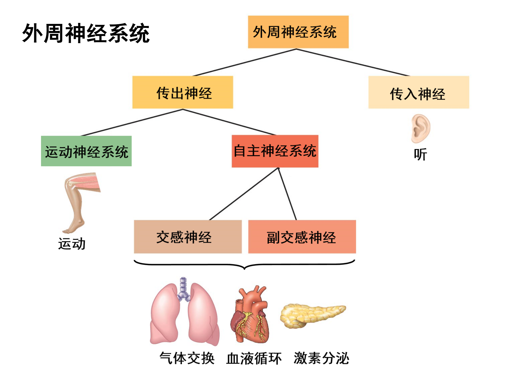

#### 1.3 神经纤维与神经元

神经纤维有髓神经纤维与无髓神经纤维两种.**有髓神经纤维**外有绝缘的髓鞘，起到绝缘作用的是施旺（Schwann）细胞.

常见的胶质细胞有星状胶质细胞，小胶质细胞，少突胶质细胞等.

神经元按突起数目可以分为**多极神经元，双极神经元，单极神经元**.**（图）**

按功能可以分为**感觉神经元  $\to$ （中间神经元） $\to$ 运动神经元**，顺序也正是完成反射过程途径神经元的顺序.

### 2. 神经调节的基本方式

#### 2.1 反射与反射弧

反射是指在中枢神经系统参与下，机体对内、外界环境刺激所产生的规律性应答反应.

反射弧是反射的结构基础，包括：**感受器、传入神经、神经中枢、传出神经和效应器**. 膝跳反射是二元反射，缩手反射是三元反射，因为经过的神经元数量不同.

兴奋除了在反射弧中传导，还会在脑与脊髓等中枢神经系统中传导，如从脊髓的低级中枢传导到大脑皮层.

反射活动需要**完整的反射弧**来实现，任何环节在结构或功能上受损，反射就不能完成.

#### 2.2 非条件反射与条件反射

反射分为非条件反射与条件反射.
- 非条件反射：生来就已经建立的先天性反射，由非条件刺激引发
- 条件反射：出生以后个体在生活中通过学习或训练逐渐形成的后天性反射，由条件刺激引发

条件反射是可以改变和重建的. 条件反射建立之后，如果反复应用条件刺激而不给予非条件刺激强化，条件反射就会逐渐减弱，最后完全不出现，称为**条件反射的消退**. 条件反射的消退并不是条件反射的丧失，而是从原先**引起兴奋（有唾液分泌）的条件反射转化成为引起抑制（无唾液分泌）的条件反射**.

巴甫洛夫（Pavlov）条件反射实验：
| 阶段 | 刺激条件 / 操作 | 反应 / 结果 |
| :---: | :--- | :--- |
| **第一阶段** | 非条件刺激（食物） | 非条件反射（唾液分泌） |
| **第二阶段** | 非条件刺激（食物） + 无关刺激（铃声） | 非条件反射（唾液分泌） |
| **第三阶段** | 无关刺激  $\to$  条件刺激 | 条件反射形成 |
| **第四阶段** | 条件刺激 + 无非条件刺激 | 条件反射消退 |

条件反射是在后天生活过程中获得，具有高度的适应性，对动物机体的生存和活动有重大意义.

### 3. 神经冲动的产生和传导

#### 3.1 神经冲动与神经纤维

蛙的坐骨神经实验情况图片：

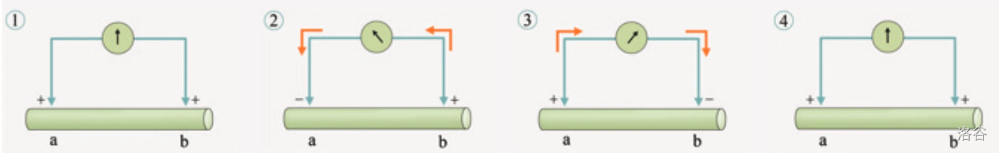

兴奋指感受器受到刺激后，由静止转入活跃状态的过程.

结论：兴奋是以电信号的形式沿着神经纤维传导的，这种电信号也叫做神经冲动.

#### 3.2 静息电位

1. 静息电位产生的原理

在未受到刺激时，神经纤维处于静息状态. 细胞膜内外两侧的存在着一个电位差，叫做**静息电位**，又称跨膜静息电位，膜电位.

静息电位都表现为膜内比膜外电位低，即膜内带负电而膜外带正电. 这种**内负外正**的状态，称为**极化状态**.

记膜外电位为 $0$，则哺乳动物的神经细胞的静息电位为 $$-70\,\text{mV}$$（即膜内比膜外电位低 70mV），骨骼肌细胞为 $$-90\,\text{mV}$$，人的红细胞为 $$-10\,\text{mV}$$.

知识回顾：细胞膜内 $\text{K}^+$ 离子的浓度高，细胞膜外 $\text{Na}^+$ 离子浓度高，钠钾泵作为主动运输实现了 $\text{K}^+$ 离子的内流与 $\text{Na}^+$ 离子的外流.

正常时细胞内的 $\text{K}^+$ 浓度和有机负离子 $A^-$ 浓度比膜外高，而细胞外的 $\text{Na}^+$ 浓度和 ${Cl}^-$ 浓度比膜内高.$\text{K}^+$ 和 $A^-$ 有向膜外扩散的趋势，而 $\text{Na}^+$ 和 ${Cl}^-$ 有向膜内扩散的趋势. 但细胞膜在安静时，对 $\text{K}^+$ 的通透性较大，对  $\text{Na}^+$ 和 ${Cl}^-$ 的通透性很小，而对 $A^-$ 几乎不通透.

静息电位的微观原理（图）

原理解释：$\text{K}^+$ **顺着浓度梯度经膜扩散到膜外**，使膜外具有较多的正电荷，有机负离子 $A^-$ 由于不能透过膜而留在膜内，使膜内具有较多的负电荷. 这就造成了膜外正、膜内负的极化状态.

由 $\text{K}^+$ 扩散到膜外造成的**外正内负的电位差，将成为阻止 $\text{K}^+$ 外移的力量**，而随着 $\text{K}^+$ 外移的增加，阻止 $\text{K}^+$ 外移的电位差也增大.

**一句话总结：K+的浓度梯度是 K+外移的驱动力；外正内负的电位差成为阻止 K+外移的力量**

#### 3.3 动作电位

2. 动作电位产生的原理：

动作电位是细胞受刺激时，产生的膜两侧的快速、可逆，并能扩散的电位.

**动作电位的微观原理（图）**

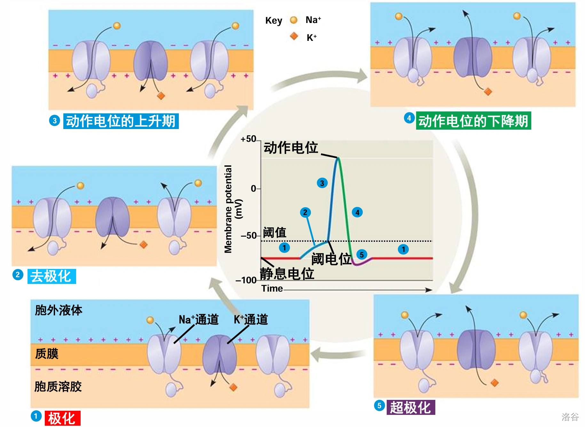

由于刺激的不同，接受刺激可能产生复极化，去极化和超极化三种结果.

**动作电位变化图（图）**

**神经冲动的传导（图）**

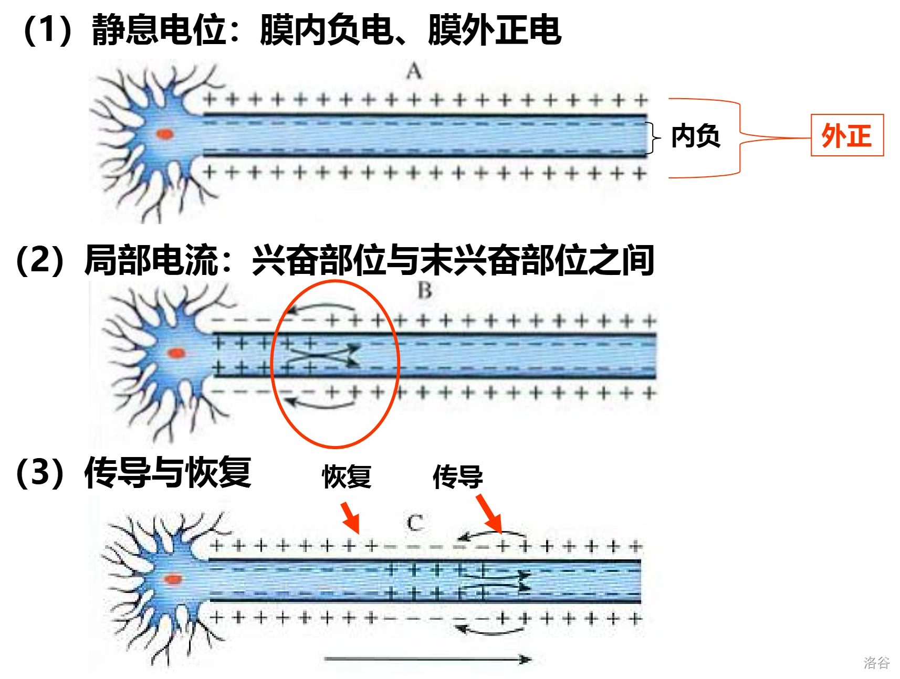

神经冲动在有髓神经纤维上传导的方式是跳跃式，大大加快了传导速度.

动作电位的出现非常快，每一动作电位大约只有 $1\,\text{ms}$ 的时间，故刺激不够强时，不发生动作电位，也就没有神经冲动.

**神经纤维传导兴奋的特征：完整性，绝缘性，双向性，相对不疲劳性**

**神经纤维传导兴奋的速度：与神经纤维的直径成正比（有髓神经纤维轴索和总直径比例 0.6 最宜），有髓>无髓，温度在一定范围内升高可使传导速度加快.**

#### 3.4 兴奋在神经元之间的传递

3. 兴奋在神经元之间的传递

突触**小体**：轴突末梢经多次分支，每个小枝末端都膨大成杯状或球状小体. 突触小体里有大量线粒体，用于为**兴奋传导**或**递质分泌**提供能量.

突触是指一个神经元的冲动传到另一个神经元或传到另一细胞间的**相互接触的结构**. 突触小体和另一神经元的树突（一般为无脊椎动物）或细胞体的表膜（一般为脊椎动物）相联系，形成突触.

突触由**突触前膜、突触间隙、突触后膜**组成. 突触分为电突触和**化学突触**. 电突触可以是双向的，而化学突触是单向的.

突触相关图示（图）

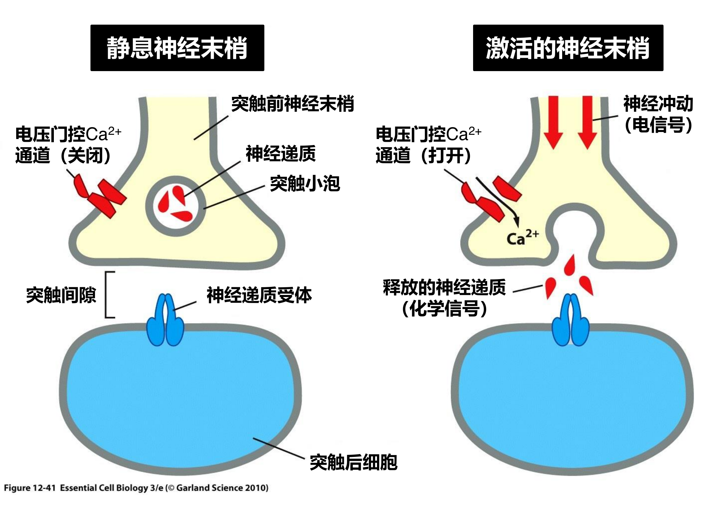

递质的分类：按结构分为乙酰胆碱，生物胺，氨基酸，神经肽与气体；按功能分为兴奋性神经递质，抑制性神经递质和双向神经递质.

兴奋性神经递质主要有谷氨酸，抑制性神经递质主要有甘氨酸，双向神经递质种类很多.

**神经冲动有兴奋性的，也有抑制性的.** 神经冲动能否通过化学突触决定于这一突触释放的递质的性质和突触后膜的性质. 如果释放的递质能使突触后膜去极化，一定量的递质就可使突触后神经元去极化而兴奋，实现神经冲动的传导，这种释放兴奋性递质的突触即兴奋性突触，同理，释放抑制性递质的突触就是抑制性突触.

兴奋传递过程：轴突兴奋  $\to$  突触小体（突触小泡）  $\to$  突触前膜  $\to$  神经递质，突触间隙  $\to$  突触后膜  $\to$ 神经元兴奋或抑制

关于神经递质：

- 产生：由**内质网与高尔基体**加工而成
- 分泌结构：突触前膜
- 受体：突触后膜上受体
- 作用：使后膜兴奋或抑制
- 去向：扩散，失活，被其他细胞吞掉等

有神经递质参与的都是化学突触，化学突触的信号经过了“电信号——化学信号——电信号”的转变过程.

### 4. 神经系统的分级调节

1. 躯体运动的分级调节

大脑中，一般感觉越精细，参与的神经元越多，面积越大.

2. 神经系统中最高级的部位是**大脑皮层**.

### 5. 人脑的高级功能

#### 5.1 脑干与睡眠

脑干（图）

**脑干和大脑**共同控制**唤醒和睡眠**（**能睡着**）. 下丘脑还调节**昼夜节律**（**睡多久**），例如睡眠/觉醒周期.

#### 5.2 小脑与运动协调

小脑：运动、感知、认知协调、学习运动

间脑（图）

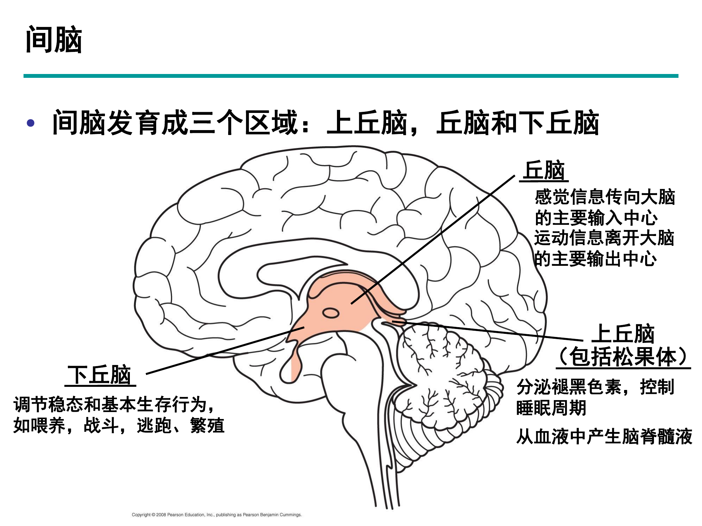

大脑（图）

基底核是规划和学习运动次序的重要中心. 胼胝体提供左右大脑皮质之间的通信.

#### 5.3 大脑的语言功能

大脑的语言功能（人类大脑皮层（左半球侧面）的言语区）：

**裂脑人实验**表明，人的语言功能在左脑. 注意裂脑人实验的实验现象，眼与手对应的脑在异侧.

#### 5.4 情绪、记忆与学习

情绪：了解海马体，下丘脑的相关功能.

记忆与学习（图）

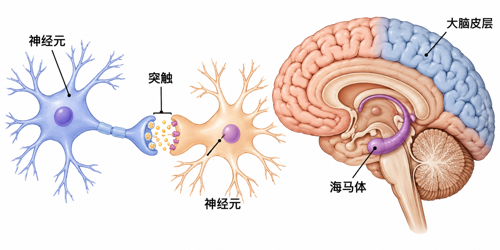

## 三、体液调节

### 1. 激素与内分泌系统

#### 1.1 激素的发现

1. 激素的发现：沃泰默的实验发现盐酸不引起神经冲动；贝利斯、斯特林假设小肠粘膜分泌促胰液素促进胰液分泌（高中常见的基本唯一**不由垂体分泌的促激素**），发现了**激素调节**，促胰液素也是第一种被发现的激素.

#### 1.2 激素与激素调节

2. 激素的定义：
  - 由特定细胞分泌
  - 对靶细胞调控
  - 有机分子

3. 激素调节的定义：由**内分泌器官**（或细胞）分泌的化学物质进行的调节.**它是体液调节的一种.**

#### 1.3 内分泌系统

4. 内分泌腺包括：下丘脑，垂体，甲状腺，胰腺 **（它不是内分泌器官，是胰岛细胞）**，肾上腺和性腺.
5. 分泌腺包括内分泌腺与外分泌腺两种. 外分泌腺有导管，**分泌物通过导管排出**. 内分泌腺无导管，分泌物从毛细血管进入血液循环.

#### 1.4 激素的分类

6. 激素的分类（图）~~pis 记忆：含氮类的氨基酸类是促进体温升高的那几个激素，~~

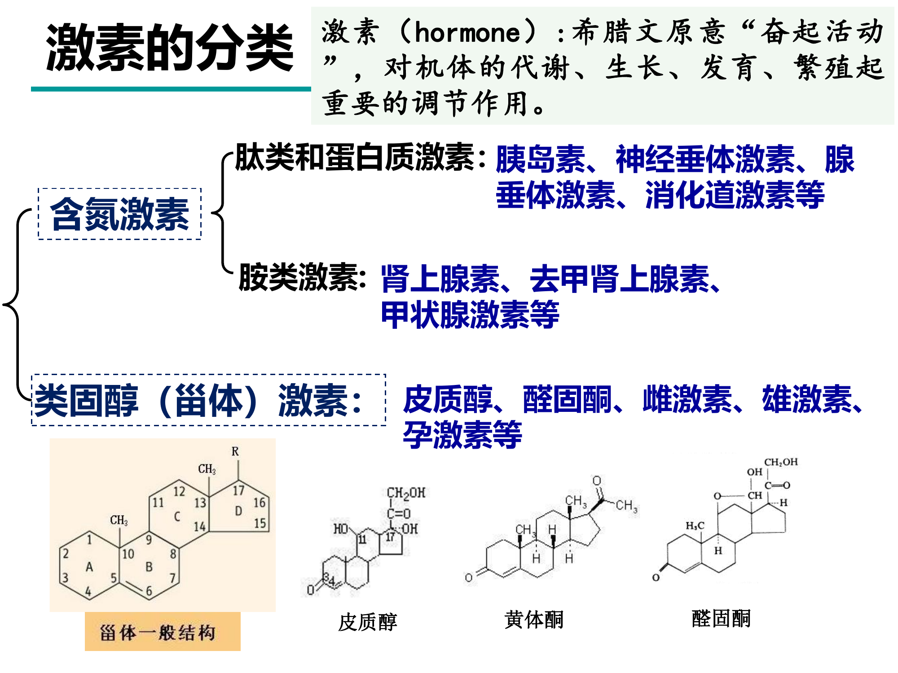

### 2. 激素调节的过程

#### 2.1 血糖调节

1. 血糖平衡的调节分为激素调节和神经调节两个方面. 影响血糖的因素有**食物糖，肝糖原与脂肪等非糖物质**等.**食物糖消化吸收为血糖，血糖通过氧化分解生成二氧化碳、水并释放能量；肝糖原分解为血糖，血糖也可以合成肝糖原，肌糖原；脂肪等非糖物质可以转化为血糖，血糖也可以转化为脂肪与某些氨基酸.**
2. 血糖的激素调节（图）、胰岛细胞的分类与功能（图）

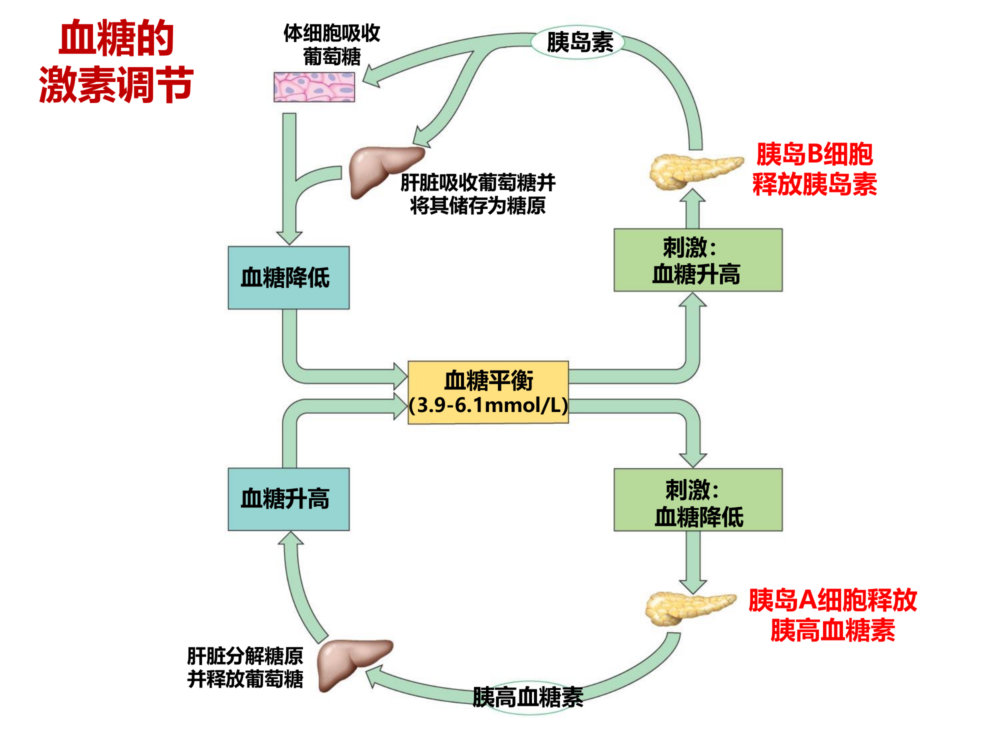

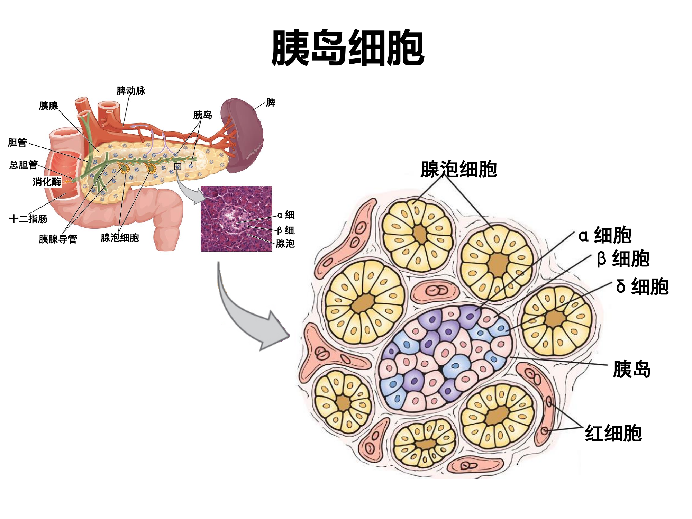

3. 血糖的神经调节（图）

#### 2.2 激素间的作用与反馈调节

4. 拮抗作用与协同作用：第一个表示两种激素的功能相同，第二个表示两种激素的功能相反.
5. 激素调节的**基本调节机制是反馈调节**：系统工作反过来调控系统工作的调节方式. 反馈调节可分为促进原工作的正反馈（血液凝固，分娩）与抑制原工作的负反馈（血压，血糖）.

#### 2.3 甲状腺激素与体温调节

6. 甲状腺激素：促进**生物的个体发育尤其是神经系统的发育**，提高**神经系统的兴奋性**，**加速体内物质氧化分解**.
7. 感知寒冷并反射的过程：
   - 1. 人体的温度感受器. 可以分为冷觉感受器与温觉感受器两种，分布在皮肤、黏膜和内脏器官内. 下丘脑是调节体温的中枢.
   - 2. 甲状腺激素分泌调节过程（图）

   - 3. 甲状腺激素分泌异常引起的疾病：幼年时缺乏会得**呆小症**，成年时分泌过少引起**甲状腺功能低下**、过多引起**甲亢**，食物中缺碘引起**地方性甲状腺肿**.

#### 2.4 生长激素与性激素

8. 生长激素相关：
   - 1. 由垂体分泌
   - 2. 作用：促进生长发育，尤其是长骨的伸长
   - 3. 分泌异常引起的疾病：幼年时缺乏会得**侏儒症**、分泌过多引起**巨人症**，成年时分泌过多引起**肢端肥大症**.
8. 性激素相关：
   - 1. 由性腺分泌
   - 2. 作用：促进生殖器官生长发育，保持第二性征.

#### 2.5 激素调节的特点

9. 总结：**激素调节的特点**：**由体液进行运输，作用于靶细胞和靶器官，作为信使传递信息，微量和高效.**

### 3. 体液调节与神经调节的关系

1. 都到这里了，自己总结一下吧，前面都有答案：神经调节的（结构与功能单位，神经调节的基本方式，反射的结构基础，兴奋在神经纤维上的传导方式，兴奋在神经元上的传递）
；激素调节的基本调节机制是（）.
2. 二者协同作用的例子：体温平衡，水盐平衡.

#### 3.1 体温调节

3. 体温调节
   - 产热量=散热量时达到平衡，热量来源主要是**肝脏（安静）与骨骼肌（运动）**；热量散失主要通过（热传导，热辐射，热对流）与汗液，毛细血管，呼吸，排尿，排便等方式实现.
   - 常见的对寒冷的反应有，血管收缩（动脉内血液流速增加），几乎不排汗，立毛肌收缩（鸡皮疙瘩），搓手（促进骨骼肌收缩）.
   - 常见的对炎热的反应有：血管舒张，大量排汗，立毛肌舒张，器官代谢减弱等.
   - **人体的体温在一定范围内波动是有益的**，比如发烧时温度偏高，而麻醉时温度偏低；
   - **人体的调节体温能力是有限的**，如中暑，冻疮.

#### 3.2 水盐平衡

4. 水盐平衡
   - 泌尿系统与肾（图）

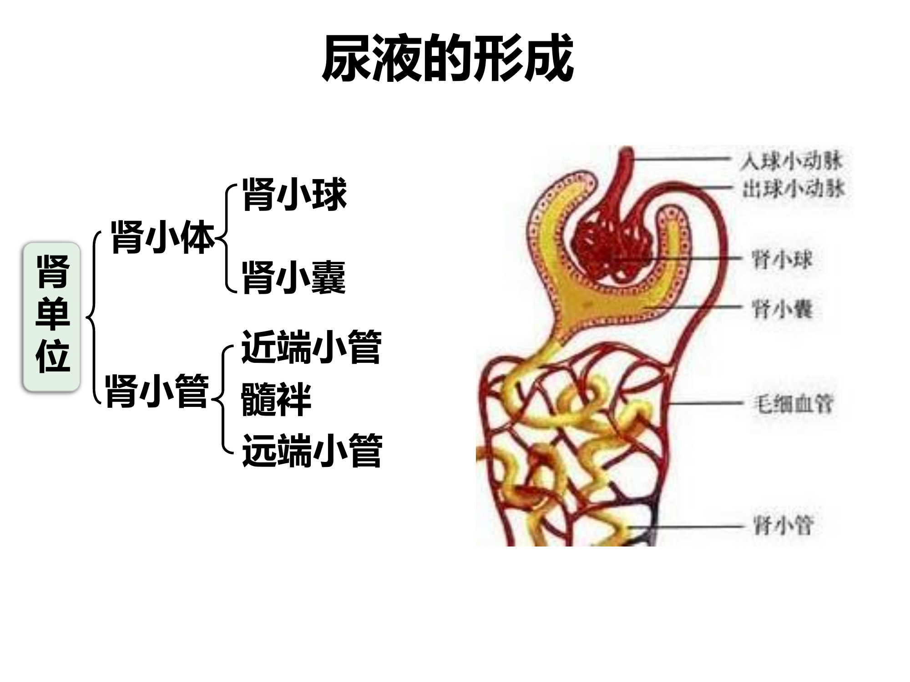

   - 水平衡的调节（图）

   - 盐平衡的调节：

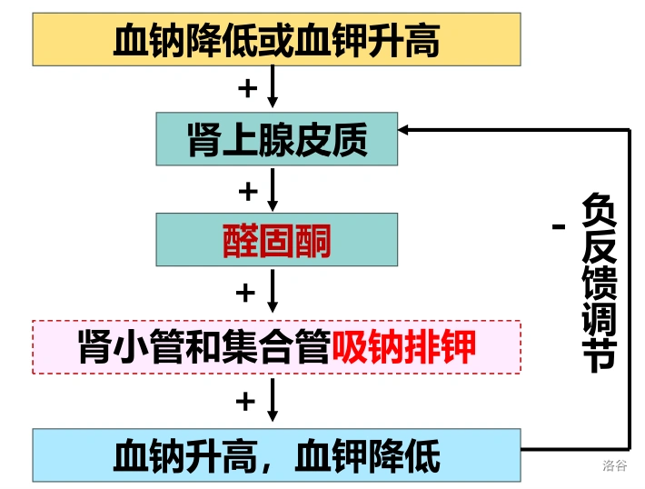

   - 相关激素：
      - **抗利尿激素（血管加压素）**：由下丘脑合成，由神经垂体释放，功能是增加肾小管和集合管对水的通透性（因为有水的通道蛋白），促进水的重吸收，最后**尿浓缩量减少**.
      - **醛固酮（肾上腺皮质）**：功能是分泌盐皮质类激素，**促进保钠，保水，排钾**.
   - 调节的盐的类型
      - **$\text{Na}$ 盐：多吃多排，少吃少排，不吃不排**，细胞外液比内液 Na 多，小肠吸收. 高温，剧烈运动，患病时会消耗 Na. 缺少 Na 会导致血压降低，心率升高，四肢发冷，外液渗透压降低. 可以补充生理盐水补充 Na.
      - **$\text{K}$ 盐： 多吃多排，少吃少排，不吃也排**，细胞内液比外液 Na 多，小肠吸收. 血钾是重要的临床指标，影响细胞内液渗透压与心肌舒张，缺少 K 可能引起心律失常.

## 四、免疫调节

### 1. 免疫系统的组成和功能

#### 1.1 免疫器官与免疫细胞

免疫是机体识别和排除病原体，保护机体不受外来侵害的特性.

免疫器官主要有**骨髓，胸腺，扁桃体，脾脏，淋巴结**. 骨髓中有红骨髓（随年龄增长会逐渐转化为黄骨髓与红骨髓各占一半，黄骨髓只是脂肪组织），具有造血功能，也是淋巴细胞初期生长的场所；脾脏能清楚衰老的血细胞；胸腺和扁桃体是部分淋巴细胞最终发育成熟的场所；淋巴结是淋巴细胞集中的地方，遍布颈部，腋窝，腹股沟等位置，能够过滤淋巴，清除入侵物.

免疫细胞分类图（图）

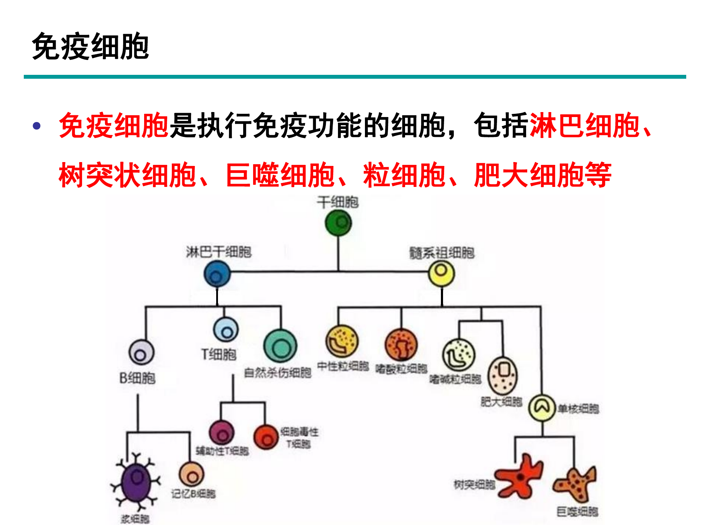

单核细胞主要包括**树突细胞与巨噬细胞**. 树突细胞的功能主要是吞噬和呈递抗原的功能；巨噬细胞（**不等于吞噬细胞，巨噬细胞是具有吞噬功能的细胞——吞噬细胞的一种**）.

淋巴细胞包括**最终从胸腺发育成熟的 T 淋巴细胞和从骨髓发育成熟的 B 淋巴细胞**.**所有 T 细胞表面均含有 T 细胞受体(TCR)**，TCR 具有特异性，可识别抗原；同时，**CD（簇分化抗原）分子**也与 T 细胞的性质相关，**大多数 T 细胞也是通过 CD4 和 CD8 两种类型的 CD 分子进行区分的**.

> **注意**：T 细胞分类方式
> - CD4 - T 细胞：除 TCR 和 CD3 外，在其表面含有 CD4 分化抗原的 T 细胞.
> - CD8 - T 细胞：除 TCR 和 CD3 外，在其表面含有 CD8 分化抗原.
> - 没有一种成熟的 T 细胞同时含有 CD4 和 CD8.

- T 淋巴细胞主要包括自然杀伤 T 细胞，**细胞毒性 T 细胞，辅助性 T 细胞**和调节性 T 细胞. 自然杀伤 T 细胞是同时具有 TCR 和自然杀伤细胞的标志物的细胞，属于“跨界细胞”；**细胞毒性 T 细胞是 CD8 - T 细胞，是产生细胞免疫的主要效应细胞，也是最主要的 T 细胞；辅助性 T 细胞是 CD4 - T 细胞，能协助 T 细胞或 B 细胞识别抗原，引起和增强免疫应答，激活其他细胞**；调节性 T 细胞能够抑制免疫过度，维持免疫耐受.
- B 淋巴细胞主要包括**浆细胞和记忆性 B 细胞**.（和 T 细胞一样，B 细胞表面也有抗原受体）浆细胞能够**合成与分泌抗体**（免疫球蛋白抗体）；记忆性 B 细胞由浆细胞分化产生，能够参与淋巴系统的再循环. 不同的记忆性 B 细胞表明的受体有所不同，因为其识别的抗原分子不一样.

#### 1.2 抗原与免疫活性物质

抗原是能够引起特异性反应的蛋白质或多糖的大分子. 常见的抗原有细菌，病毒，癌细胞，花粉等. 人体吞噬、处理并呈递抗原的过程是通过**抗原呈递细胞**完成的，**抗原呈递细胞只能呈递抗原给 T 细胞**，而不是 B 细胞.

免疫活性物质包括抗体，溶菌酶与细胞因子. 抗体主要分布在血浆中，也分布在淋巴与外分泌液中，起到与抗原结合的作用；溶菌酶能够溶解细菌的细胞壁以杀死细胞；细胞因子是分子较小的“信使”，白细胞介素、干扰素、肿瘤坏死因子是主要的细胞因子.

#### 1.3 免疫防线与免疫功能

常见的抗体（图）包括 **IgM,IgG,IgA,IgE,IgD**.

人体的三道免疫防线（图）

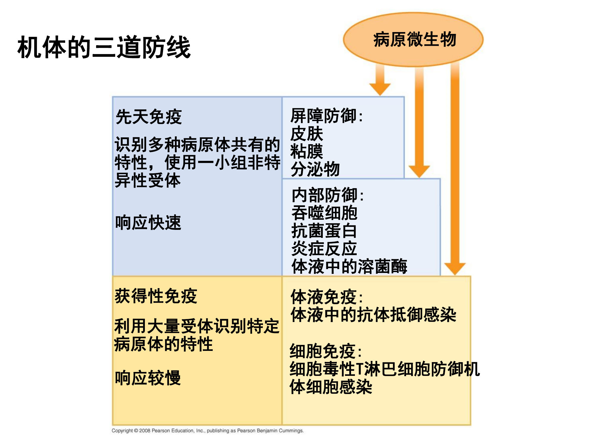

**屏障防御**主要包括皮肤和粘膜，部分溶菌酶；

**内部防御**主要包括部分溶菌酶，吞噬作用，炎症反应，补体，干扰素，温度反应等. 溶菌酶的工作机制是溶解细胞膜；白细胞和吞噬细胞能够吞噬细菌；身体受到损伤之后血管的通透性变化导致炎症水肿；补体蛋白通过识别抗原与抗体的复合物溶解细胞膜，促进吞噬细胞的吞噬和释放组织胺以促进炎症反应；干扰素是细胞在受到攻击之后向其他细胞释放的信号，能够促进抗病毒蛋白的合成；巨噬细胞与入侵的微生物相遇能够释放白细胞介素 1 的细胞因子，能够提高人体温度，促进吞噬作用.

**特异性免疫**主要包括细胞免疫与体液免疫两个方面.

**免疫系统的功能：免疫防御，免疫自稳，免疫监视.**

### 2. 特异性免疫

#### 2.1 抗原识别与特异性免疫过程

淋巴细胞通过识别人体的 MHC（主要组织相容性复合体）判断是否为病毒（先考虑抗原中的蛋白质类，多糖类抗原一般可溶，不需要 MHC）.

人的 MHC 成为人白细胞抗原 HLA.HLA 可以分为两类，MHC - I 和 MHC- II. 其中 MHC - I 位于所有有核细胞的表面上（**包括抗原呈递细胞**），MHC - II 位于抗原呈递细胞的表面上.MHC - I 能够被 CD8 - T 识别，也就是说 MHC - I 能够激活细胞毒性 T 细胞；MHC - II 能够被 CD4 - T 识别，也就是说 MHC - I 能够辅助性 T 细胞.

MHC 的结构都是抗原在细胞外，MHC - II 可以对加工后的抗原肽呈现在细胞外. 细胞能够吞入抗原并利用溶酶体拆解抗原，并且最终让抗原肽与 MHC - II 结合并放到细胞表面.

特异性免疫的过程包括**感应阶段，反应阶段，效应阶段**. 感应阶段能够识别并处理抗原，反应阶段能够使淋巴细胞增殖，效应阶段是效应细胞和记忆细胞发挥功能.

注意，T 细胞也有其对应的记忆细胞.

感应阶段，对于抗原获得的信息，抗原呈递细胞只能把信息呈递给 T 细胞，而进一步的，辅助 T 细胞能够把信息传递给 B 淋巴细胞.

反应阶段，淋巴细胞接受抗原信息后分化出现淋巴母细胞，浆母细胞与记忆细胞. 淋巴母细胞最终成为效应 T 细胞，浆母细胞最终成为浆细胞，效应 T 细胞和浆母细胞是终末细胞，不再增殖，寿命短；记忆细胞体积小，寿命长，使机体能够长期对抗某种抗原.

效应阶段，效应 T 细胞执行细胞免疫作用，浆细胞合成并分泌抗体.

人体的特异性免疫包括细胞免疫与体液免疫两个阶段.

#### 2.2 细胞免疫

一、细胞免疫

**T 细胞是细胞免疫的主要细胞**，整个细胞免疫过程大致如下：

抗原被细胞识别的过程包含两个阶段：1. 抗原和 MHC 结合 2.T 细胞识别抗原并结合.

免疫过程主要有：
- 辅助 T 细胞识别抗原
- 辅助 T 细胞提供信息给细胞毒性 T 细胞或细胞毒性 T 细胞与抗原结合
- 细胞毒性 T 细胞识别靶细胞
- 分泌穿孔素 + 颗粒酶
- 杀死细胞，内容物流出

杀死细胞的方式主要是：穿孔素 + 颗粒酶或直接让细胞凋亡.

杀死细胞之后，细胞的内容物流出到体液中，进入体液免疫.

#### 2.3 体液免疫

二、体液免疫

**B 细胞是体液免疫的主要细胞**，整个体液免疫过程大致如下：

抗体与抗原形成特异结合，再通过下列反应消灭抗原：

中和反应：抗体结合抗原以便吞噬细胞吞噬，是**多个抗体结合 1 个抗原**；

聚集反应：抗体是双价的，可以使抗原聚集，以便吞噬，是**多个抗体结合多个抗原**；

沉淀反应：抗体结合后，使可溶性抗原大分子沉淀，以便吞噬；

激活补体：激活补体后是靶细胞裂解.

体液免疫应答的一般包括**初次免疫应答与二次免疫应答**. 初次免疫应答强度弱，反应慢；二次免疫应答强度大，反应快.

特异性免疫总流程（图）

### 3. 免疫失调

#### 3.1 过敏反应

过敏反应：

- 特点：
  - 发作迅速，反应强烈，消退较快；
  - 一般不会破坏组织细胞；
  - 有明显的遗传倾向和个体差异.
- 初次接触过敏原致敏，再次接触致敏原会导致过敏.
- 流程：

- 过敏反应的原因是组织胺. 组胺能够 引起毛细血管扩张、血管壁通透性增强，平滑肌收缩和腺体分泌增多等.

#### 3.2 自身免疫病

免疫病：

- 免疫系统过于灵敏、反应过度、“敌我不分”将自身物质当作外来异物进行攻击.
- 如：类风湿性关节炎，风湿性心脏病、系统性红斑狼疮.

#### 3.3 免疫缺陷病

免疫缺陷病：

- 指由机体免疫功能不足或缺乏而引起的疾病；
- 分为：先天性免疫缺陷病，获得性免疫缺陷病. 大多数是获得性免疫缺陷病.

#### 3.4 艾滋病

艾滋病（HIV 病毒引起）：
- 发病原理：HIV 病毒入侵免疫细胞并逆转录复制 DNA，通过整合宿主 DNA，完成复制过程，并通过翻译组合蛋白质外壳，产生新的病毒，通过破坏细胞组织、膜结构，最终大量释放入血.
- 艾滋病的传播途径：性传播，血液传播，母婴传播.

### 4. 免疫学的应用

#### 4.1 疫苗

疫苗是指用各类病原微生物制作的用于预防接种的生物制品,通常是用灭活或减毒的病原体制成.

疫苗分为减毒活疫苗和灭活疫苗. 减毒活疫苗免疫效果好，作用时间长，但不易保存，有回复变异的风险；灭活疫苗毒性低，但免疫效果弱，作用时间短. 常见的减毒活疫苗有脊髓灰质炎糖丸；裂解疫苗也是灭活疫苗的一种.

#### 4.2 疾病检测与器官移植

疾病检测：通过查是否有特异性抗体（如激素与病原体抗原或抗体）实现

器官移植：使用免疫抑制剂. 移植的器官可以用干细胞培养（得到诱导多能干细胞）.

## 五、植物生命活动的调节

### 1. 植物生长素

#### 1.1 植物的向性运动

1. 植物具有应激性，植物感受刺激产生反应有两种基本方式：感性运动和向性运动，分别由不定向的外界刺激引起和定向的外界刺激引起.

   代表性的向性运动有向光性运动，向地性运动.

   上面的内容能够表明**植物对环境的适应性**.

#### 1.2 生长素的发现

2. 生长素的发现：胚芽鞘起到了关键作用，能够引导植物的生长.

- 胚芽鞘能保护生长中的胚芽. 种子萌发时，胚芽鞘首先钻出地面，出土后还能进行光合作用.
- 1880 年，达尔文（Darwin）的向光性实验表明，胚芽鞘弯向光源生长是由**单侧光**引起；感受光刺激的部位是**胚芽鞘的尖端**；向光弯曲生长的部位是**胚芽鞘尖端的下段**.

- 1910 年，鲍森·詹森（Boysen-Jensen）（丹麦）的实验表明，胚芽鞘尖端产生的**刺激物可以透过琼脂片向下传递**.

- 琼脂是一种多糖，可用作增稠剂、凝固剂、悬浮剂、乳化剂、保鲜剂和稳定剂；云母是铝硅酸盐，在电工产品中广泛应用云母及其制品作为绝缘材料.
- 1914 年，拜尔（匈牙利）的实验与 1928 年温特（荷兰）进一步的实验表明，胚芽鞘的尖端确实产生了某种
物质，这种物质从尖端运输到
下部，并且能够**促使胚芽鞘下
方某些部位的生长**. 这种物质就是**生长素**.

- 总结：胚芽鞘的生长**具有向光性**；胚芽鞘的**生长与光无关，与尖端有关**；胚芽鞘的**向光性生长与单侧光的刺激有关**；胚芽鞘感受单侧光刺激的部位是胚芽鞘尖端；胚芽鞘的生长部位是胚芽鞘的尖端下段；尖端产生了促进生长的物质—吲哚乙酸.

#### 1.3 生长素的化学本质

3. 生长素

- 1931 年，荷兰科学家科戈（F. Kogl）从人的尿液中分离和纯化了一种能刺激生长的物质,加入到琼胶中，同样能诱导胚芽鞘弯曲，经鉴定为**吲哚乙酸（IAA）**. 具有生长素效应的还有：**苯乙酸（PAA）、吲哚丁酸（IBA）**.
- 植物向光弯曲的原理：单侧光使**背光一侧**比向光一侧**生长素分布得多**，进而使得植物**背光一侧的细胞纵向生长的快**，结果使得**茎朝向生长慢的一侧弯曲**.

#### 1.4 生长素的合成、分布与运输

4. 生长素的合成、分布与运输：

   - 生长素产生部位集中在植物生长旺盛的区域，包括**顶端分生组织（根尖，茎尖，芽尖等）、幼嫩的叶片. 发育中的种子**等.
   - 生长素分布广泛且不均匀. 其主要分布在上面提到的生长素产生部位与发育中的果实和种子，次要分布在成熟的根、茎等部位，但浓度远低于生长旺盛区. 这里涉及了茎尖的结构，但是应该不考（图）.
   - 生长素的运输的**极性运输**，即**从形态学的上端向形态学下端运输**. 除此之外，生长素在尖端也可以**由单侧光引起横向运输**.

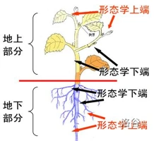

横向运输是在受地心引力、单侧光等刺激时发
生的，这导致生长素不均匀分布，引发弯曲生长.

#### 1.5 生长素的极性运输实验

5. 教材实验：

   为了检测生长素的运输方向，某人做了如下实验. 取一段玉米胚芽鞘，切去顶端 2 mm，使胚芽鞘不再产生生长素. 在上端放一块含有生长素的琼脂，下端放一块不含生长素的琼脂（胚芽鞘形态学上端朝上）. 过一段时间检测，发现下端的琼脂块逐渐有了生长素.

   根据实验设计及结果，此人得出以下结论：（1）下端琼脂块上的生长素来自上端的琼脂块；（2）生长素在胚芽鞘内只能由形态学的上端运输到形态学的下端.

> **题**：问题：从实验结果到结论之间的逻辑推理是否严谨？如果要验证上述结论，应该如何改进实验方案？
>
> **解**：答案：不严谨. 实验只证明了生长素可以从形态学上端运送到形态学下端，但是没有证明反方向不能运输. 另外，也不能排除重力的影响，所以也不能确定是极性运输还是被动的扩散；改进的方法是增加实验对照组，取另一段同样切去顶端的胚芽鞘，**将其形态学上端朝下放置**，其余处理与原实验一致，此时如果倒置组的受体琼脂块中检测不到生长素，而正置组检测得到，即可说明运输方向由形态学极性决定，也同时排除了重力的影响.

   补充：另外，有实验证明，在缺氧时，生长素的运输受到影响. 这说明生长素的运
输是一种消耗 ATP 的主动运输.

6. 练习：

> **题**：1. 判断下列各胚芽鞘的生长情况
>
> 
>
> **解**：答案：直立生长，直立生长，弯向光源生长，不生长也不弯曲.

> **题**：
>
> 
>
> **解**：答案：A.

#### 1.6 生长素的生理作用

7. 生长素的生理作用：**促进植物生长，促进植物生根，促进果实发育，防止落花落果**.

   从细胞水平上看，生长素可以影响细胞的伸长、分裂和分化. 从器官水平上看，生长素可以影响器官的生长、成熟和衰老. 生长是细胞量的变化，发育是细胞分化的过程，成熟指生物体发育到完备的阶段.

#### 1.7 不同器官对生长素的敏感性

8. 不同器官对生长素的浓度敏感性不同.

    - **低浓度促进生长，高浓度抑制生长**，过高的浓度甚至可以引起**脱分化**；
    - **幼嫩细胞敏感，衰老细胞迟钝**，这与**顶端优势**有关；
    - **不同的器官对生长素敏感程度不同**，从大到小有**根>芽>茎**；

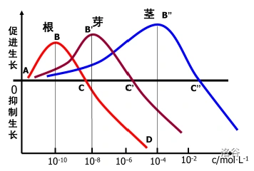

    - 营养器官的敏感程度大于生殖器官；
    - 双子叶植物的敏感程度大于单子叶植物，这决定了调整生长素类似物的浓度可以起到去除杂草的作用. 双子叶植物是种子具有两片子叶的植物，**杂草**是双子叶植物；单子叶植物是种子具有一片子叶的植物，**小麦、水稻、玉米**是单子叶植物. 二者可以用如下方式区分：

#### 1.8 生长素作用的两重性

9. 生长素的生理作用的特点是**两重性**. 它既能促进生长，也能抑制生长；既能促进发芽，也能抑制发芽；既能防止落花落果，也能疏花疏果. 这些都有其浓度和分布等因素密切相关.

   生长素的两重性的代表性例子有：

   - **顶端优势**：植物的顶芽优先生长，而侧芽生长受到抑制的现象. 形成原因是顶芽产生的生长素向下运输，大量地积累在侧芽部位，**侧芽对生长素浓度又比较敏感**，使侧芽的生长受到抑制. 可以通过**修剪整枝**去除，应用有棉花打顶，茶园剪枝等.
   - **茎的背地性和根的向地性生长**.
> **题**：练习：放置一株水平方向的幼苗，培养一段时间后，根、茎生长的方向如何？
>
> 
>

     由于根和茎对生长素的敏感程度不同，所以植物产生了弯曲，这样的弯曲是符合我们的植物生长方向的普遍认识的.

> **题**：练习：放置一株水平方向的幼苗在太空的宇宙飞船中，培养一段时间后，根、茎生长的方向如何？
>
> **解**：答案是没有背地性和向地性生长.

### 2. 其他植物激素

发现生长素之后，科学家又陆续发现了**赤霉素、细胞分裂素、脱落酸、乙烯**等植物激素.

植物激素是由植物体内产生，能从产生部位运送到作用部位，对植物体的生长发育有显著影响的微量有机物.

#### 2.1 赤霉素

1. 赤霉素
   - 发现历程：人们发现水稻感染赤霉菌之后植物尤其是茎会疯狂生长而不结穗，这就是得了恶苗病. 但人们发现这个症状不是赤霉菌的分生孢子作用导致的，是赤霉素导致的.
   - 合成部位：主要是**未成熟的种子、幼芽、幼根**.
   - 主要作用： 促进细胞伸长，从而引起植株增高（对根的伸长没作用，促进的是**茎的伸长**）；**促进种子萌发，打破块茎休眠**；促进**果实发育**.
   - 对比生长素和赤霉素：
     |  种类  |  生长素  |  赤霉素  |
     |:----:|:----:|:----:|
     |  产生  |  分生组织，形成层等幼嫩部位，分布不均匀  |  未成熟的种子、幼芽、幼根  |
     |  作用  |  促进营养器官的生长，**主要是根**；促进形成层的细胞分裂和根的分化（插条发根的原理）；维持顶端优势；施于叶片的生长素抑制叶片脱落（抑制离区的形成）；促进单性结实及单性果实的发育；过量时效果会被抑制.  |  加速细胞的伸长，**主要是茎**；促进种子萌发，打破块茎休眠；促进麦芽糖的转化（诱导α-淀粉酶形成）；促进果实、茎块发育成熟；促进雄花的形成；防止器官的脱落.  |
     |  原理  |  生长素诱导细胞壁酸化并使其可塑性增大而导致细胞伸长.  |  赤霉素改变了基因的表达，能够提高生长素含量，让钙离子进入细胞，使细胞壁变疏松，以进一步使植物体生长.  |

     下面几个点是补充的，可以不看：

     离区：使植物器官（如叶、花和果）脱离母株的组织，称为离区. 如：“瓜熟蒂落”的“蒂”.

     单性结实：子房不经过受精作用而形成不含种子的果实的现象.

     生长素使细胞伸长的原理示意图

     赤霉素对大麦等谷物种子萌发过程中养分的动员作用

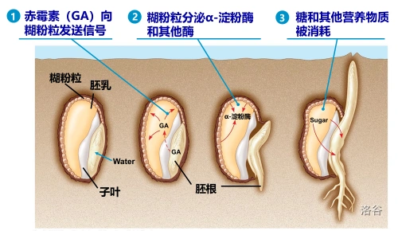

#### 2.2 细胞分裂素

2. 细胞分裂素

   - 合成部位：**根尖**.
   - 主要作用：引起**细胞分裂**，促进**芽**的**分化**、侧枝**发育**、**叶绿素合成（保绿）**、防止离体叶片衰老.
   - 从图中可以看出，生长素和细胞分裂素各司其职，促进整个植物体生长.

   - 当**生长素浓度大于细胞分裂素**时，植物组织进行**脱分化形成愈伤组织**. 当**生长素浓度小于细胞分裂素时**，植物愈伤组织进行**再分化**.
   - 当**生长素/细胞分裂素比值高**，促进**根的生长、分化**；当**生长素/细胞分裂素比值低**，主要促进**芽的分化、生长**.
   - **综合来看，生长素主要促进根，赤霉素主要负责茎，细胞分裂素主要负责芽.**
   - 植物组织培养的步骤：离体的植物器官、组织或细胞先脱分化为愈伤组织（排列疏松而无规则，高度液泡
化的呈无定形状态的薄壁细胞），再分化为根或芽等器官，以形成新的植物体.

#### 2.3 脱落酸

3. 脱落酸
   - 合成部位：根冠、萎蔫的叶片等.
   - 分布：将要脱落的器官和组织.
   - 主要作用：抑制细胞分裂，促进气孔关闭，促进叶和果实的衰老和脱落，**维持种子休眠、抑制发芽**.

#### 2.4 乙烯

4. 乙烯
   - 合成部位：植物体各个部位.
   - 主要作用：促进果实成熟，促进开花（雌花），促进叶、花、果实脱落.
   - 枫叶脱落的过程中，植物生长素和乙烯的平衡变化控制了叶片的脱落.
> **题**：5. 练习：植物激素应用在园艺上效果显著. 回答下列问题：
> - 成熟的香蕉不宜搬运和储存，蕉农在香蕉尚绿时及时采收，果贩如何处理以促进香蕉适时成熟？**乙烯催熟**
> - 优良果树的繁殖常用扦插法，果农如何处理枝条使扦插成功？**适宜浓度的生长素（或生长素类似物）处理扦插枝条下端，以便生根**
> - 马铃薯在储存中易发芽而失去市场价值，农户应用哪一种激素抑制发芽？**脱落酸**
> - 欲使矮茎花卉长高，使用哪一种植物激素最具功效？**赤霉素**
> - 在植物细胞培养基中，要用哪些植物激素？**细胞分裂素和生长素**
>
植物生长激素总结（图）

#### 2.5 植物激素的相互作用

6. 植物的生长发育过程，不是受单一激素的控制，而是受多种激素协调作用所控制. 类比人的激素的协同作用和拮抗作用，植物激素也有促进作用和拮抗作用.
   激素调节只是植物生命活动调节的一部分，植物的生长发育过程，本质上是**基因组在一定时间和空间上程序性表达的结果**，而基因的表达也会受环境因素的控制.

**所以，植物激素不是植物生命活动的控制者，只是调节者，控制者则是基因组和环境因素.**

常见的促进作用和拮抗作用：

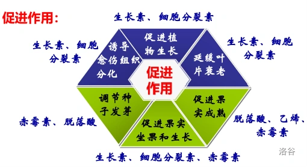

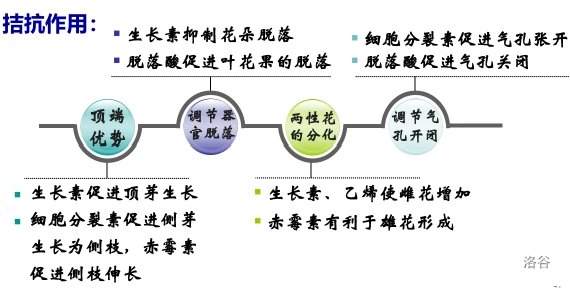

### 3. 植物生长调节剂的应用

#### 3.1 植物生长调节剂的特点

植物生长调节剂是人工合成的、对植物的生长、发育有调节作用的化学物质（比如生长素类似物），有**原料广泛、容易合成、效果稳定**的特点.

#### 3.2 常见植物生长调节剂

常见的植物生长调节剂的类型和应用有：
- 用 GA(赤霉素)打破莴苣、马铃薯、人参种子的休眠；促进苋菜、芹菜等茎的营养生长，增加产量；
- 用α-萘乙酸（NAA，生长素的类似物）促进甘薯、黄杨、葡萄的生根；对苹果、鸭梨进行疏花疏果，促进脱落；对棉花进行保花保铃，防止脱落；
- 用乙烯利促进黄瓜、南瓜的雌花分化；促进香蕉、柿子、番茄的果实成熟；
- 施用矮壮素（生长延缓剂）抑制棉花生长，促进结实等.

#### 3.3 生长素类似物的应用

生长素在植物体内含量很少，提取困难，易分解，所以常常使用人工合成的**生长素类似物**，生理作用与生长素类似，但不容易被降解，因此效果稳定，在生产上有广泛的应用. 如**α-萘乙酸（NAA）**、**2,4-二氯苯氧乙酸（2,4-D）** 等.

三个应用：

#### 3.4 促进扦插枝条生根

1. **促进扦插枝条生根**：用一定浓度的生长素类似物溶液浸泡插枝的下端后栽插（浓度范围低于根的最适浓度）.

   植物体的器官、组织甚至细胞中在不同的轴向上存在某种形态结构
和生理生化上的梯度差异，这在生物学上称为极性，极性是植物分化中
的一个基本现象，极性一旦建立，即难于逆转.**极性使扦插的枝条生不
定根有一定的顺序位置，最容易生不定根的是形态学下端，其次是节上，
在枝条所有节中离形态学下端最近的节又是最容易生不定根.**

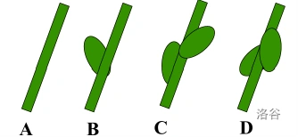

   所以，图示的 ABCD 在其他条件相同时，C 先长出根.

#### 3.5 除草剂

2. 除草剂：如 **2,4-二氯苯氧乙酸(2,4-D)**，适用于麦田、稻田.

   双子叶植物比单子叶植物对生长素更敏感，用高浓度的除草剂能抑制双子叶植物（杂草）的生长.

   **2,4-D：能引起染色体变异.**

#### 3.6 促进果实发育

3. 促进果实发育：培育无子果实.
   - 原理：用一定浓度的生长素类似物刺激未授粉的雌蕊柱头或子房.

   - 方法：花蕾期去雄，雌蕊柱头上涂抹一定浓度的生长素，套袋.**其染色体数目与正常果实一样.**
   - 复习：无籽西瓜与多倍体形成原理：秋水仙素可以使植物染色体翻倍，所以无籽西瓜是四倍体与二倍体杂交出的三倍体，联会紊乱，所以没有种子.

## 六、种群及其动态

### 1. 种群的数量特征

#### 1.1 种群的概念

种群：在一定空间和时间内的同种生物的全部个体的总和. 种群是生物繁殖和生物进化的基本单位. 判断时注意**“空间和时间”，“同种”，“全部”**.

> **题**：练习：下列各项属于种群的有
>
> - A — 一亩农田中的全部水稻
> - B — 一片森林中的全部蕨类
> - C — 一口池塘中全部鲫鱼
> - D — 一个村子里的全部葡萄
> - E — 一片森林中的全部蛇
> - F — 一个农民种的全部水稻
> - G — 一窝蚂蚁
> - H — 一个狼群
> - I — 一片草原上全部老鼠
>
> **解**：答案：ACGH.BDEI 不一定是同一物种，F 的空间限制不明确.

物种：物种是互交繁殖的相同生物形成的自然群体，与其他相似群体在**生殖上相互隔离**，并在自然界占据一定的生态位. 其特征主要有：成员具有自然杂交的潜能，并能繁殖出可育后代，无法与其他种群的成员繁殖具有生育能力的可繁殖后代.

- pis：生态位是指一个种群在生态系统中，在时间空间上所占据的位置及其与相关种群之间的功能关系与作用.

物种形成是新物种从旧物种中分化出来的过程，即从一个种内产生出另一个新种的过程. 物种形成的判断**不能应用于无性生物，化石和其他人类并不了解的生物**.

生殖隔离：不同种群的个体间不能交配，或交配不育，或不能产下有繁殖能力的后代，导致种群间不能发生基因交流的现象，本质是**物种依靠生殖隔离，保持其遗传的特质**.

**生殖隔离是物种形成的必要条件.** 生殖隔离可以分为合子前障碍与合子后障碍.

合子前障碍包括：

**生境隔离**（Habitat isolation）：也叫生态隔离（Ecological isolation），两个物种生活于同一区域，但栖息地不同，无法相遇. 比如束带蛇分水栖和陆生两种.

**时间隔离**（Temporal isolation）：也叫季节隔离（Seasonal isolation），植物花期不同，动物繁殖期不同. 两个物种在不同时间、不同的季节或不同的年份交配. 比如西部斑臭鼬和东部斑臭鼬，虽然领地有重叠，但西部斑臭鼬在夏末交配，而东部斑臭鼬在冬末繁殖.

**行为隔离**（Behavioral isolation）：通常取决于求偶方式. 相近的物种间，如鸟类，往往采用不同的求偶仪式. 如信天翁的求偶舞，蓝脚鲣鸟的求偶行为.

**机械隔离**（Mechanical isolation）：生殖器官的形态差异会阻止交配成功. 如蜗牛壳的螺旋方向必须相同，两个蜗牛才能交配成功；**植物的拟态也能造成机械隔离**，比如花朵可以用不同的外观吸引不同的授粉媒介.

**配子隔离**（Gametic isolation）：一种物种的精子可能无法使另一种物种的卵受精. 常见的例子有水中受精的物种，它们的精子和卵子往往不会互相吸引；植物花粉难以在异种柱头上萌发.

合子后障碍包括：

**杂种不活**（Hybrid inviability）：杂合子不能发育或不能发育到性成熟而死亡. 比如火蝾螈属的杂交新物种剑螈，大多数蝾螈的杂交后代不能完成发育.

**杂种不育**（Hybrid sterility）：杂种合子能发育，个体能达到性成熟，并且是强壮的，但却是不育，比如骡子，虎狮兽与狮虎兽等.

**杂种衰败**（Hybrid breakdown ）：第一代杂种是能存活而且是可育的，但当子一代杂种彼此间交配或同任一亲本交配，其子代却是衰弱或者不育的. 比如杂交水稻，F1 子代能存活，但是 F2 子代却不能表现出优良性状，所以杂交水稻需要年年育种.

种群相关的概念辨析：

> **题**：1. 对于生物个体来说生命是有限的，但是对于一个种群来说，一般会不会因为个体的消失而消失呢？
>
> **解**：种群一般不会因为个体的消失而消失，因为虽有个体的死亡，但是他们的后代在继续延续下去.

> **题**：2. 一般来说生活在同一区域的是不是只有一个种群？
>
> **解**：生活在同一区域中肯定不止一个种群.

> **题**：3. 是不是任何同种个体的总和都能称为一个种群？
>
> **解**：不是任何同种个体的总和都能称为种群，**必须是生活在一起的，彼此相互之间存在联系.**种群不等于个体的简单累加，种群内个体之间通过特定关系构成一个有机整体，从而能表现出个体不具有的特征.

#### 1.2 种群的数量特征

1. **种群密度**：在单位面积或单位体积中的个体数. 是种群最基本的数量特征.
  表示方法：
- 小范围的水生生物——**单位体积**
- 大范围水生生物及陆生生物——**单位面积**

  **计算公式**：
  **种群密度** = 种群的个体数量 / 空间大小.

  特点：①不同物种的种群密度往往差异很大.②同一物种的种群密度在不同环境条件下也有差异，如一片农田中的东亚飞蝗，在夏天种群密度较高，在秋末天气较冷时则降低.

  迁徙，洄游，耕种和相关生物等能引起种群密度的周期性变化. 影响种群密度的因素主要有：
  > 1. 物种的个体大小——个体大的密度低；
  > 2. 生存资源的供给能力——资源丰富密度高；
  > 3. 环境条件的周期性变化引起种群密度周期性变化——候鸟，鱼的洄游；
  > 4. 外来干扰——农田喷洒农药后，害虫大量死亡；
  > 5. 天敌数量的变化；
  > 6. 偶然因素——如流行病、水灾、旱灾……

  调查方法：

  **样方法**：在被调查的种群分布范围内，随机选取若干个样方，通过计数每个样方内的个体数，求得每个样方的密度，以所有样方种群密度的**平均值**作为该种群的种群密度估计值. 使用范围是**不运动或活动范围小的生物**，如植物，昆虫卵的密度等. 样方的大小和数目依据总面积而定，大小合适、数目越多结果越接近实际值.

  取样方法：

  五点取样法指在对角线和中心取 5 个样方，等距取样法指等间隔地取多个样方.

  计算方法：统计方框内+相邻两边（左+上）及其夹角上的个体. 如下图的统计结果是 8 个.

  若要调查某一池塘中鲫鱼的种群密度，可以使用标志重捕法：在种群的活动范围内，捕获一部分个体，做上标记后再放回原处，一段时间后再重捕，根据重捕的动物中标记个体数占总个体数的比例，来估计种群密度. 使用范围是活动能力强和范围大的动物.

  **计算公式**：
  $$N=\dfrac{Mn}{m},$$

  其中 $N$ 是种群数量，$M$ 是标记个体数，$n$ 是重捕个体数，$m$ 是重捕中被标记数量.

  成立条件：
  1. 标志个体在整个调查种群中均匀分布，标志个体和未标志个体都有同样被捕获的机会；
  2. 调查期中，没有迁入或迁出；
  3. 没有新的出生或死亡.

2. 出生率和死亡率：在单位时间内新产生（或死亡）的个体数目占该种群个体总数的比率.

  意义：出生率和死亡率是决定种群数量和种群密度的直接因素. 其中：

  - 出生率>死亡率时，种群密度加大；
  - 出生率=死亡率时，种群密度相对稳定；
  - 出生率<死亡率时，种群密度变小.

  定义**自然增长率=出生率-死亡率**. 自然增长率的正负一定程度上能够反映种群密度的变化.

3. 迁入率和迁出率：对于一个种群来说，单位时间内迁入或迁出的个体，占该种群个体总数的比率.

  意义：迁入率和迁出率是决定种群数量和种群密度的直接因素. 其中：

  - 迁入率>迁出率时，种群密度加大；
  - 迁入率=迁出率时，种群密度相对稳定；
  - 迁入率<迁出率时，种群密度变小.

4. 年龄组成和性别比例：一个种群中各年龄期个体数目的比例；种群中雄性个体和雌性个体所占的比例.

   年龄组成的意义：通过影响种群的出生率和死亡率，间接影响种群密度，可预测种群密度和种群数量的变化趋势

   分类：雌雄相当型，雌多雄少型，雌少雄多型.

   使用性引诱剂能够诱杀某种害虫的雄性个体，破坏性别比例，起到杀虫作用.

   人口结构金字塔主要分三种，增长型，稳定型，衰退型.

#### 1.3 种群的空间特征

种群的空间特征是指组成种群的个体在其生活空间中的位置状态或空间布局，包括**均匀分布、随机分布、集群分布**.

- 均匀分布是指种群在空间按一定间距均匀分布，这种分布通常是在种内斗争与资源利用之间的平衡状态下形成的，如农田生态系统中的水稻种植，森林中某些乔木的分布等.

- 随机分布指每一个体在种群领域中各个点上出现的机会相等，并且某一个体的存在不影响其他个体的分布；通常在环境资源分布均匀，种群内个体间没有彼此吸引或排斥的情况下才会出现. 如森林地被层中的一些蜘蛛，面粉
中的黄粉虫等.

- 集群分布最常见，指个体倾向于聚集在一起形成群体；这种分布有利于种群在资源有限的环境中更好地生存和繁殖. 如欧椋鸟在黄昏时分成群飞起的行为，就是一种典型的集群行为.

重要知识点：

> **注意**：**种群数量变化**是种群研究的核心问题，**种群密度**是种群的重要特征.
>
> **出生率和死亡率、迁入率和迁出率**是决定种群数量变化的**主要**因素.
>
> **年龄组成，性别比例可以影响**种群的数量变化.
>
> **年龄组成**是预测种群数量变化的主要依据.

种群分类（图）.

> **题**：练习：下列因素**一定**能引起种群密度增大的有：
>
> - A — 种群中幼年个体增多
> - B — 种群性别比例改变
> - C — 环境中水热条件适宜
> - D — 种群中幼年个体减少
> - E — 环境中天敌增多
> - F — 环境中阳光不足
> - G — 寄生生物增多
> - H — 寄生生物减少
>
> **解**：答案：ACH

### 2. 种群数量的变化

一、我们可以基于数学方法建构种群增长模型.

#### 2.1 种群增长的“J”型曲线

1、模型假设：
- 理想状态——食物充足，空间不限，气候适宜，没有敌害等；
- 种群的数量每年以一定的倍数增长，第二年是第一年的 $\lambda $ 倍.

2、种群“J”型增长的数学模型公式：$N_t = N_0 \lambda^t$

($N_0$ 为起始数量，$t$ 为时间，$N_t$ 表示 $t$ 年后该种群的数量，$\lambda$ 为种群数量是前一年的倍数.)

#### 2.2 种群增长的“S”型曲线

由于自然界中的资源是有限的，种群数量达到环境所允许的最大值（K 值）后，将停止增长并在 K 值左右保持相对稳定. 种群经过一定时间的增长后，数量趋于稳定的增长曲线，称为“S”型曲线.

K 值是指在环境条件不受破坏的情况下，一定空间中所能维持的种群最大数量称为环境容纳量.

> **题**：为了保护鱼类资源不受破坏，并能持续地获得最大捕鱼量，应使被捕鱼群的种群数量保持在什么水平？为什么？
>
>
> 
>
>
> **解**：根据种群增长的 S 型曲线，应使被捕鱼群的种群数量保持在 $\dfrac{k}{2}$ 水平. 因为在这个水平上**种群增长量最大**.
>
> **题**：抓大放小的捕鱼方式对吗？**不对.** 因为抓大放小会促使鱼被自然选择，平均体型减小，所以长期采取抓大放小的策略不合适.

> **题**：家鼠的繁殖力很强，种群数量每天可增加 1.47%.
>
> 理论上，在某一区域，10 只家鼠在 100 天后的数量将会达到多少？（这里就不算了）
>
> 你考虑应当采取什么措施来控制家鼠的数量才是最有效的？原理是什么？**尽早防治，在增长率小的时候灭鼠**，尤其是在种群数量低于环境容纳量的一半以下时灭鼠.

> **题**：怎样做才是保护大熊猫的根本措施？建立自然保护区，改善大熊猫的栖息环境，提高环境容纳量.

#### 2.3 种群数量的波动和下降

自然界中多数生物种群都已达到稳定期. 大多数种群的数量总是在波动之中的. 在不利条件之下，还会急剧下降，甚至灭亡.

### 3. 影响种群数量变化的因素

#### 3.1 影响种群数量变化的因素

种群的数量是由出生率和死亡率、迁入率和迁出率决定的，因此，凡是影响上述种群特征的因素，都会引起种群数量的变化.

#### 3.2 种群研究的应用

1. 有利于野生生物资源的合理利用及保护.
2. 为人工养殖及种植业中合理控制种群数量、适时捕捞、采伐等提供理论指导.
3. 通过研究种群数量变动规律，为害虫的预测及防治提供科学依据.
4. 有利于对濒危动物种群的拯救和恢复.

#### 3.3 生物入侵

生物入侵指生物由原生存地经自然的或人为的途径侵入到另一个新的环境，对入侵地的生物多样性、农林牧渔业生产以及人类健康造成经济损失或生态灾难的过程.

对于特定的生态系统与栖境来说，任何非本地的物种都叫作外来物种.

外来入侵物种具有生态适应能力强，繁殖能力强，传播能力强的特点.

生物入侵的危害有破坏景观的自然性和完整性，摧毁生态系统，危害生物多样性，影响遗传多样性的危害.

10 大有害入侵物种是澳大利亚的兔子，野葛，欧洲椋鸟，缅甸蟒，海蟾蜍，灰松鼠，蛇头鱼，老鼠，杀人蜂，亚洲鲤鱼. 其他入侵物种有刺梨，大米草，巴西彩龟，克氏原螯虾，食人鲳，飞机草，福寿螺.

## 七、群落及其演替

### 1. 群落的结构

池塘里有多种生物，如浮游植物、浮游动物、植食性鱼、肉食性鱼、微生物等. 假如池塘中的肉食性鱼大量减少，池塘中其他种群的数量将会出现什么变化？

#### 1.1 群落的概念与特征

由于肉食性鱼减少，小型水生动物增加，浮游动植物减少，植食性鱼减少. 这表明不同种群之间相互联系，形成了**群落**.

群落是**同一时间内聚集在一定区域中各种生物种群的集合**.

> **例**：一个池塘中的鱼类是一个种群，还是一个群落？
>
> **解**：都不是. 因为池塘中还有微生物和植物等生物.

群落的特征，也就是在群落水平上研究的问题，主要包括物种多样性、群落结构和种间关系等.

不同群落靠**物种组成**进行区分，物种数目的多少用**丰富度**表示.

不同群落的优势物种不同，种群数量和种群中个体数量差别也很大. 一般来说，环境条件愈优越，群落发育的时间愈长，物种数目愈多（丰富度越高），群落的结构也愈复杂.

读者请自行比较下列群落的物种丰富度：

- 平原与山地；
- 草地与林地；
- 远离大陆的岛屿与大陆附近的岛屿；
- 群落间的过渡地带与非过渡地带.

两个或多个群落间的过渡地带称为**群落交错区**，如海陆交界的潮间带、河口湾，以及森林与草地或农田交界的地带. 这些区域的生物种类和数量常比相邻群落中多，这种现象称为**边缘效应**.

#### 1.2 种间关系

物种间的关系主要有 **原始合作（互惠）**、**互利共生**、**捕食**、**寄生**和**种间竞争**五种.

相关例子如下：

- 原始合作：寄居蟹与海葵；
- 互利共生：地衣、白蚁和肠内鞭毛虫、豆科植物和根瘤菌、人与人体肠道菌群、小丑鱼与海葵；
- 捕食：略；
- 寄生：蛔虫、绦虫、血吸虫等寄生在动物体内，虱和蚤寄生在动物体表，菟丝子寄生在豆科植物上，噬菌体寄生在细菌内部；
- 竞争：红松鼠与灰松鼠.

**捕食关系**：

**寄生关系**：

**种间竞争关系**：

区分原始合作和互利共生的关键在于：双方**是否依赖这种关系生存**.

竞争和捕食的结果不同：

竞争的结果可能是种群数量或比例稳定，也可能是一方处于优势、另一方处于劣势并最终灭亡；捕食的结果是两个种群相互制约，种群数量保持相对稳定.

#### 1.3 群落的空间结构

**群落的空间结构**包括**垂直结构**和**水平结构**两种. 垂直结构中，植物的分层主要与光照有关，动物的分层主要与食物有关. 群落层次性越明显，分层越多，群落中的动物种类也就越多.

> **题**：
>
> （1）引起植物分层分布的主要原因是什么？
>
> **解**：光照强度.
>
> （2）引起动物分层分布的主要原因是什么？
>
> **解**：食物、栖息场所等.
>
> （3）群落的垂直结构出现分层现象的意义是什么？
>
> **解**：使生物群落在单位面积上能容纳更多的生物种类和数量，提高群落利用环境资源（如阳光、空间、营养物质等）的能力.

分层现象的意义：

- 缓解植物之间争夺阳光、空间、水分和矿质营养等的矛盾，扩大植物利用环境的范围，提高同化功能的强度和效率；
- 动物的分层现象主要与食物有关，其次还与不同层次的微气候条件有关；
- 水域中，影响浮游动物垂直分布的原因主要有阳光、温度、食物和含氧量等；
- 群落中植物的分层现象决定了动物的分层现象.

**水平结构**是在水平方向上，由于地形变化、光照强度、土壤湿度和盐碱度等环境因素的差异，不同生物分布于不同地段的现象. 植物群落水平结构的主要特征是具有镶嵌性. 镶嵌性出现的原因是植物个体在水平方向上的分布不均匀，从而形成许多小群落；分布不均匀还受到地形、土壤湿度和盐碱度、光照强度、生物自身生长特点以及人和动物活动等因素影响.

> **例**：某座山海拔 2042 米，800 米以下为常绿阔叶林，800 至 1300 米为针阔混交林，1300 至 1600 米为针叶林，1600 至 1800 米为灌木林，1800 米以上为草地. 植物的这种分带现象属于什么结构？
>
> **解**：水平结构. 这种分带由海拔（地形）造成的温度和湿度差异引起，而不是由生物自身差异引起.

垂直结构与水平结构的区别：

- 垂直结构的分层现象是由生物本身的高度或活动空间的高度造成的；水平结构的分段是由环境的光、热、水及地形等条件对生物的选择造成的；
- 垂直结构和水平结构都是指不同种生物的分布差异. 同种生物个体之间的差异不能构成垂直结构或水平结构，也不因同种生物分布一致而影响垂直结构或水平结构的存在.

> **题**：乔木、灌木、地被是由植物高度带来的差异，属于哪种结构？
>
> **解**：垂直结构.

#### 1.4 群落的季节性与生态位

**群落的季节性**指群落的组成和外貌随时间而发生有规律的变化，主要分为**昼夜变化**和**季节变化**两类. 昼夜变化的例子有猫头鹰活动，季节变化的例子有候鸟迁徙、蝙蝠等生物冬眠.

扩展：研究生物活动随季节发生变化的学问称为**物候学**. 群落的季节性也决定于植物与传粉动物之间的协同进化过程.

一个物种在群落中的地位或作用，包括所处的空间位置、占用资源的情况，以及与其他物种的关系等，称为这个物种的**生态位**. 动物的生态位主要包括栖息地、食物、天敌和种间关系等；植物的生态位包括出现频率、种群密度、植株高度和种间关系等.

群落结构（图）.

### 2. 群落的主要类型

常见的生物群落主要有**农田生物群落、海洋生物群落、森林生物群落、荒漠生物群落、草原生物群落和湿地生物群落**等.

### 3. 群落的演替

#### 3.1 群落的发展

群落是一个**动态的开放的**生命系统.

由于气候变迁、洪水、火烧、山崩、地壳运动、动物活动和植物繁殖体的迁移散布，以及群落自身活动改变内部环境等自然原因，或者由于人类活动的影响，群落结构会受到干扰或破坏. 一些生物种群消失后，其他种群会占据它们的空间；经过一段时间，又会有另一些种群兴起，最终达到相对稳定的阶段.

随着时间的推移，一个群落被另一个群落代替的过程称为**演替**.

发生在裸岩上的演替分为以下几个阶段：

演替过程中，生物种类不断增多.

- **裸岩阶段**：岩石的主要成分是碳酸钙、硅酸盐、二氧化硅等无机物. 苔藓和草本植物无法直接从裸岩中获取养分，地衣可以通过分泌有机酸从裸岩中获取养分，因此地衣能够定居. 地衣是真菌和藻类的**共生体**；
- **地衣阶段**：地衣遍布岩石表面，是植物界的开路先锋和拓荒者，是六亿年前地球上的首批旅人；
- **苔藓阶段**：苔藓的生长会进一步使岩石分解，土层加厚，有机物增多，土壤中的微生物群落也越来越丰富；
- **草本阶段**：各种昆虫和小动物开始进入该地区，土壤中有机物越来越丰富，土壤的通气性越来越好；
- **灌木阶段**：灌木的出现为其他生物提供栖息地，物种多样化使群落结构较为稳定；
- **森林阶段**：物种进一步多样化，生物与环境之间的关系变得更加丰富多样，群落结构相对稳定.

**初生演替**是在一个从来没有被植物覆盖的地面，或者原来存在过植被但被彻底消灭的地方发生的演替，如沙丘、火山岩、冰川泥上的演替.

**次生演替**指原有植被虽已不存在，但原有土壤条件基本保留，甚至还保留了植物的种子或其他繁殖体（如能发芽的地下茎）的地方发生的演替，如火灾过后的草原、过量砍伐的森林、弃耕的农田.

演替不能一直进行下去. 当群落演替与当地的气候和土壤等条件处于平衡状态时，演替就不再进行，达到平衡点. **顶极群落**就是群落演替的最终平衡状态阶段，是最复杂、最稳定的群落阶段. 如果没有外力干扰，它将永远保持原状.

弃耕农田上的演替与裸岩上的演替过程不完全相同，流程大致为一年生杂草、多年生杂草、小灌木、灌木丛、乔木.

#### 3.2 人类活动对群落演替的影响

人类可以砍伐森林、填湖造地、捕杀动物，也可以封山育林、治理沙漠、管理草原，甚至建立人工群落. 人类活动往往会使群落演替按照**不同于自然演替的速度和方向进行**.

现在，**退耕还林、退牧还草、退田还湖**是实现最重要的方式之一.

> **题**：据调查，近 5 万年以来，某地区由于气候越来越干燥，森林逐渐被灌丛取代. 近 50 年来，由于人类过度开垦，导致局部灌丛出现荒漠化. 与该地区自然演替相比，人类开垦活动使群落演替速度发生了什么变化，演替方向是否发生改变？
>
> **解**：演替速度变快，演替方向发生改变. 人为开垦导致局部荒漠化，属于逆行演替（退化演替）：群落结构变简单，物种丰富度下降，生产力降低，群落向更简单的方向发展.

> **题**：为什么大面积围湖造田是洪灾频繁发生的原因之一？
>
> **解**：湖面大大缩小，蓄洪容积减小，蓄洪能力降低.

长期以来，我国农业发展史实际上是一部边际土地开垦史. 20 世纪 50 年代以来，先后在黑龙江三江平原、新疆和华南地区有计划地组织大规模垦荒，在其他江河、荒原、沼泽和丘陵地区也开展了规模不等的垦殖活动. 1952～1990 年，全国累计开垦的荒地中，80% 是 1970 年以前开垦的. 开垦的结果是水土流失、江河蓄洪能力下降、土地严重退化，农牧渔业生产能力和环境质量下降. 我国已实施大规模退耕还林、退田还湖、退牧还草等重要政策，并从 2003 年 1 月起开始实施《退耕还林条例》.
