## 一、人体内环境的稳态

### 1. 细胞生活的环境

#### 1.1 生物生存在环境中

血细胞生活在血浆中，草履虫生活在外界水环境中.

二者都生活在液体环境中，但**血细胞**生活在血浆中，并不直接与外界环境进行物质交换，而**草履虫**生活在外界环境，直接与外界环境进行物质交换.

#### 1.2 血浆、血液与血清

- **血浆**：血液**加入抗凝剂**后静置一段时间，上层的**淡黄色液体**；
- **血清**：血液**凝固后上层淡黄色液体**，与血浆相比**不含纤维蛋白原**.

血液凝固过程如图所示：

凝血过程中，纤维蛋白形成的网有助于形成血凝块.

血液组成如图所示：

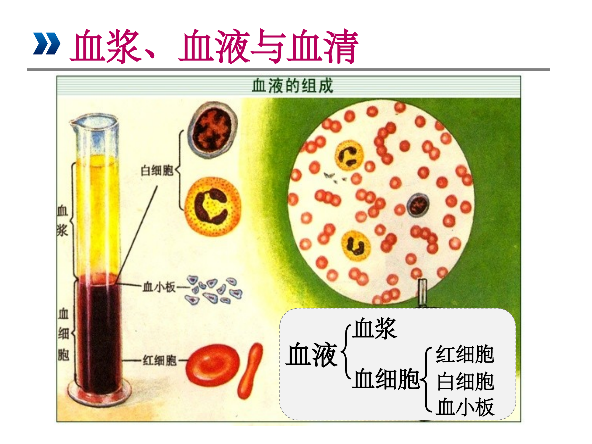

血液由血浆和血细胞组成；血细胞包括红细胞、白细胞和血小板.

#### 1.3 体内细胞生活在细胞外液（内环境）中

人体内以水为基础的液体统称为**体液**，包括**细胞内液**和**细胞外液**. 细胞外液构成体内细胞直接生活的**内环境**.

内环境主要由血浆、**组织液**与**淋巴液**组成. 血浆位于血管内，组织液存在于细胞间隙，淋巴液位于淋巴管内.

人体的体液中，细胞外液约占三分之一，细胞内液约占三分之二. 对这几种液体按量排序有：细胞内液 $>$ 组织液 $>$ 血浆 $>$ 淋巴液.

> **注意**：汗液、尿液、消化液、泪液、唾液属于体液吗？**不**. 膀胱腔、消化道、口腔、呼吸道、肺泡腔与外界环境相通，因此汗液、尿液、唾液等不属于体液，属于**体内的外界环境**.

> **题**：写出下列细胞生活的内环境.
>
> **解**：
>
> - 血细胞：血浆；
> - 组织细胞：组织液；
> - 淋巴液中的淋巴细胞、吞噬细胞：淋巴液；
> - 毛细血管壁细胞：血浆、组织液；
> - 毛细淋巴管壁细胞：组织液、淋巴液；
> - 口腔上皮细胞、皮肤细胞：组织液.

#### 1.4 细胞外液间的相互转化

**（1）转化方向与比例**：如图所示.

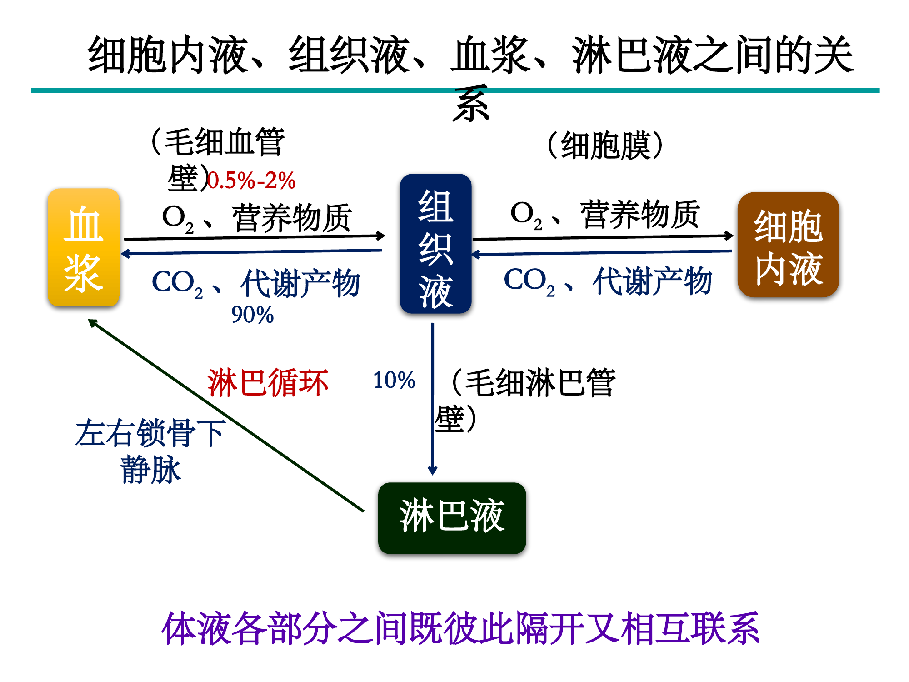

血浆、组织液和淋巴液之间存在物质交换与转化.

**（2）微循环**：如图所示.

毛细血管的特点：

- 分布广泛；
- 管壁薄，单层细胞；
- 管径小，红细胞单行通过；
- 血流速度最慢.

**（3）血压的组成**：

- **毛细血管血压**：血液流动产生的压力，由流速决定；
- **血浆胶体渗透压**：血浆的蛋白质产生的向血管内「吸引物质」所产生的压力，对动静脉相同，是**负值**；
- **组织液胶体渗透压**：组织液的蛋白质产生的向血管外「吸引物质」所产生的压力，对动静脉相同，是**正值**；
- **组织液静水压**：组织液流动在血管上产生的压力，对动静脉相同.

将四者相加，得到有效滤过压 $+13$ 与 $-2$，而这决定了动脉与静脉的血液流动方向.

而为了让体液的转换正常进行，大小上，**毛细血管动脉端压力 $>$ 组织液压力 $>$ 毛细淋巴管压力 $>$ 静脉压力**.

上述的水压，正方向向血管外，负方向向血管内.

**（4）淋巴循环**：相对独立于机体其他系统的一个管网状结构. 循环过程如图所示：

淋巴的功能：**组织液回流**的通道，**免疫和防御**，**脂类**物质代谢过程中的输送管道（如小肠就可将营养直接吸收进淋巴管）.

淋巴回流的意义：回收血浆丧失的蛋白质，调节血浆、组织液之间的液体平衡，免疫和防御，运输脂类物质代谢产物.

**（5）组织液**：影响组织液生成的因素：**有效滤过压**；毛细血管**通透性**；静脉和淋巴回流等.

#### 1.5 人体内环境的概念与血浆的化学组成

**人体内环境**是指由细胞外液（血浆、组织液和淋巴液）构成的液体环境.

血浆的化学成分及参考含量如表所示：

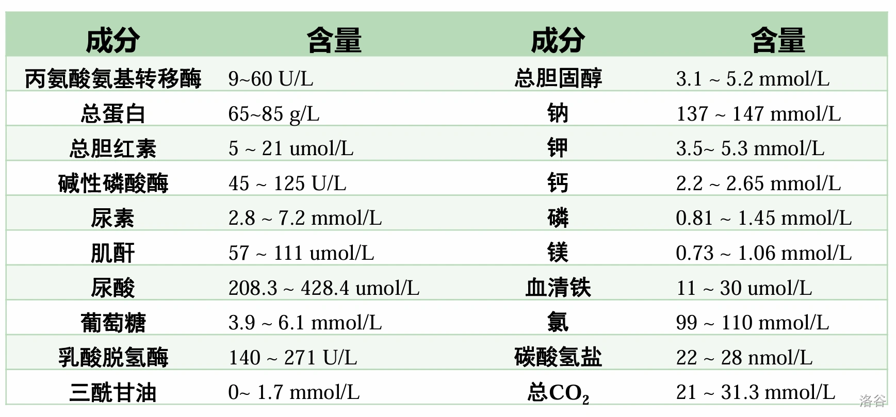

**分类方式①**：

- 无机物：水、无机盐；
- 有机物：糖、蛋白质、脂类.

**分类方式②**：

- 营养物质：水、无机盐、葡萄糖、蛋白质、甘油三酯等；
- 代谢废物：尿素、尿酸、肌酐、$\text{CO}_2$.

还有激素、维生素、$\text{O}_2$ 等.

血浆中包含的最主要的离子是 $\text{Na}^+$、$\text{Cl}^-$.

血浆成分的近似比例如图所示（不同资料和个体可能略有差异）：

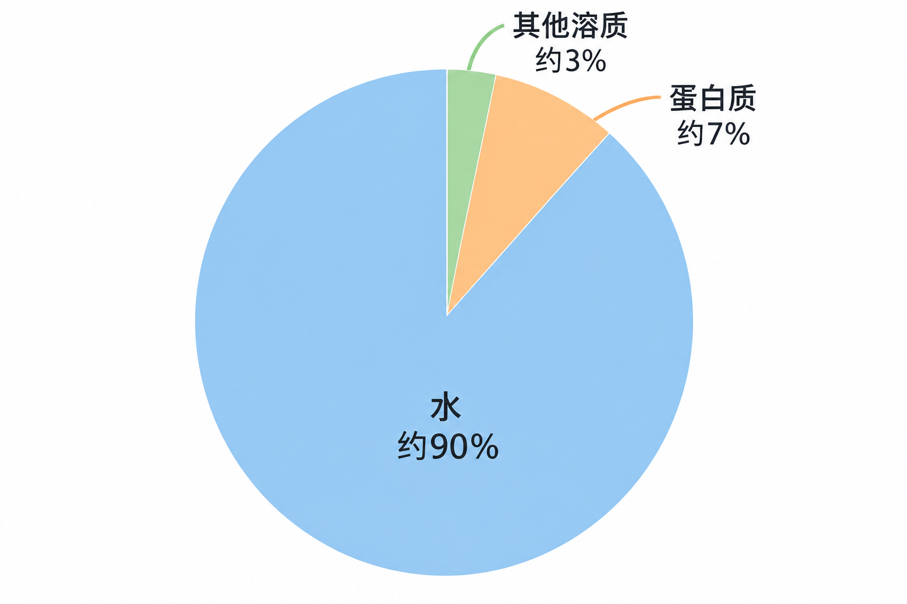

> **说明**：本图为生成的示意图，比例为近似值. 可参见 [OpenStax 血液组成](https://openstax.org/books/biology-2e/pages/40-2-components-of-the-blood)和 [血浆蛋白](https://openstax.org/books/anatomy-and-physiology/pages/18-1-an-overview-of-blood).

血浆蛋白主要为**清蛋白**（又名白蛋白，最主要的蛋白质，维持人体运转）、**球蛋白**（免疫，抗体）和**纤维蛋白原**（凝血和止血）.

清蛋白的作用：

- 维持血浆胶体渗透压的恒定；
- 非专一性运输蛋白，能与体内许多难溶性的小分子有机物和无机离子可逆地结合形成易溶性的复合物；
- 保证细胞内液与细胞外液间的交流；
- 对球蛋白起到一种胶体保护的稳定作用；
- 人体内一种重要的营养物质；
- 具有黏性、胶质性，可自动与重金属离子结合，起到解毒的作用.

#### 1.6 内环境的理化性质

**渗透压的形成**：用半透膜把两种不同浓度的溶液隔开时发生渗透现象，到达平衡时半透膜两侧溶液产生的位能差（多的向少的一方走）.

用半透膜隔开两种不同浓度溶液时的渗透现象如图所示：

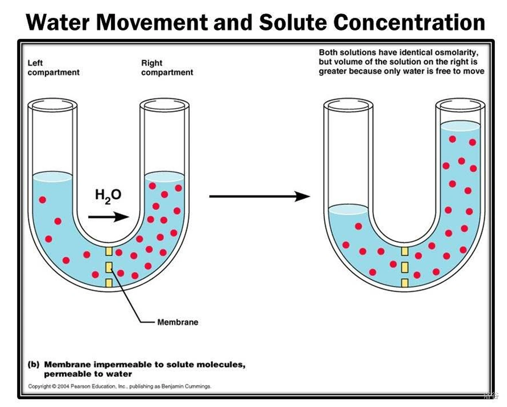

**渗透**是水的被动运输. 动物细胞在低渗、等渗与高渗溶液中的形态变化如图所示：

**渗透压**：溶液中**溶质微粒**对**水**的吸引力（回想一下血压中说过的两个渗透压的形成过程）.

- 单位体积溶液中溶质微粒越多 $\to$ 溶液浓度越高 $\to$ 对水的吸引力越大 $\to$ 溶液渗透压越高；
- 细胞外液渗透压 90% 以上来源于 $\text{Na}^+$、$\text{Cl}^-$；
- $37\,\text{℃}$ 时，人的血浆渗透压 $=$ 细胞内液渗透压 $=$ $770\,\text{kPa}$ $=$ 淋巴液渗透压 $=$ 组织液渗透压，物质能平衡地进出细胞.

血浆渗透压的分类如图所示：

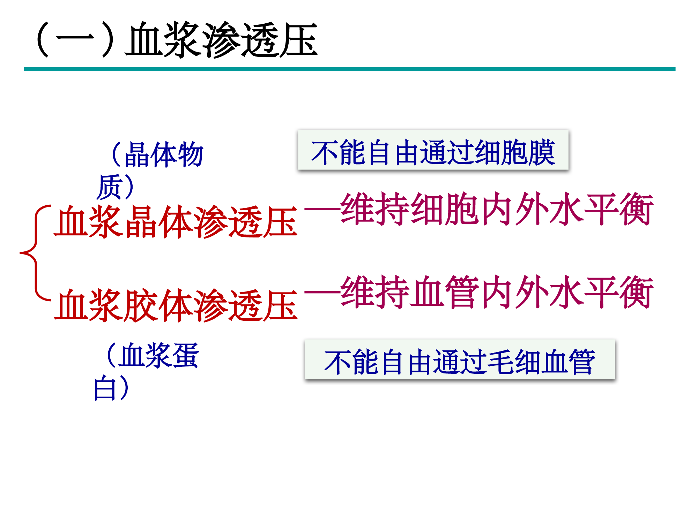

血浆渗透压可按形成它的溶质分为晶体渗透压和胶体渗透压.

**血浆酸碱度**：

- 维持在 $7.35\sim7.45$ 之间；
- 通过碳酸与磷酸的**缓冲对转化**调节（原理就是酸的电离与水解）.

**总结**：内环境的理化性质：体温 $37\,\text{℃}$ 左右，渗透压 $770\,\text{kPa}$，$\text{pH}$ 为 $7.35\sim7.45$.

#### 1.7 细胞与外界环境的物质交换

- 呼吸系统（同初中背的，动静脉血与顺序）；
- 消化系统：小肠绒毛吸收营养成分；
- 循环系统；
- 泌尿系统；
- 细胞通过内环境与外界进行物质交换.

物质交换过程如图所示：

细胞通过内环境与外界环境交换物质.

### 2. 内环境的稳态

#### 2.1 体温变化规律

- 正常人体温 2～6 时最低，14～16 时最高；
- 儿童体温 $>$ 成人体温 $>$ 老人体温；
- 女性体温 $>$ 男性体温，女性经前期、妊娠早期轻度升高，月经期较低.

#### 2.2 化验指标

一张血液生化检验报告单如图所示：

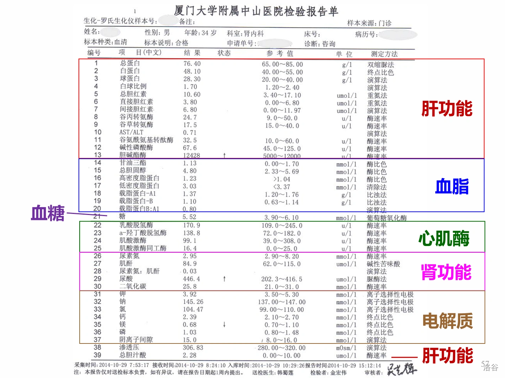

- **丙氨酸氨基转移酶**存在于肝细胞中，如果肝脏发生炎症、坏死、中毒等损害，转氨酶就会由肝细胞释放到血液中，所以**肝脏本身的疾患**可引起不同程度的转氨酶升高；
- **肌酐与尿素氮**是衡量肾功能的一项指标，当肾功能发生障碍时，代谢废物不能排出体外，以致大量含氮废物和其他毒性物质在体内积累，严重时导致**尿毒症**；
- **血清葡萄糖**是血液中**血糖**浓度的一项指标，对于诊断以及指导治疗**糖尿病**具有重要意义；
- **糖化血清蛋白**反映过去 1～3 周**平均**血糖浓度（蛋白与葡萄糖结合是不容易的，所以该指标反映长期的血糖情况）；
- **甘油三脂和总胆固醇**是衡量血液中**血脂**水平的一项指标. 高脂血症与**冠心病**有密切的关系，尤其是胆固醇与甘油三脂皆增高的，患冠心病的危险性更大.

#### 2.3 稳态及其调节机制

正常机体通过调节作用，使各个器官、系统协调活动，共同维持内环境的相对稳定状态叫做**稳态**. 人体各器官、系统协调一致地正常运行，是维持内环境稳态的基础. 内环境稳态是机体进行正常生命活动的必要条件.

**神经—体液—免疫调节**网络是机体维持稳态的主要调节机制. 稳态破坏则导致生病.

稳态遭到破坏时，将导致代谢紊乱，导致疾病，如血液中 $\text{Ca}$、$\text{P}$ 含量降低时，会导致**骨软化病**（成年）或**佝偻病**（儿童）；血钙过高会导致**肌无力**.

## 二、神经系统与神经调节

### 1. 神经调节的结构基础

#### 1.1 神经系统的组成

人的神经系统组成如图所示：

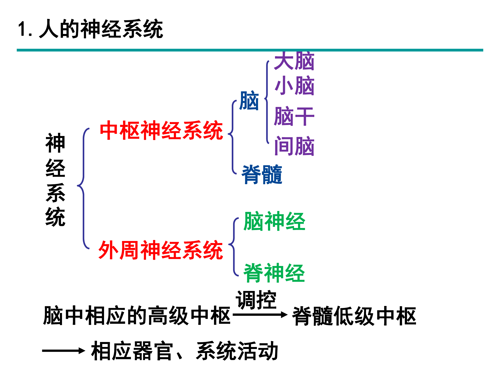

高级中枢调控低级中枢，进而控制相应器官与系统活动.

- **大脑**：两个半球，包含大脑皮层，**灰质**在外；
- **小脑**：维持身体平衡；
- **脑干**：调节呼吸与心脏等必要中枢；
- **间脑**：控制体温与节律.

脊髓中**白质**在外：

- **白质**：轴突（神经纤维）；
- **灰质**：胞体和树突.

#### 1.2 自主神经系统

**自主神经系统**：支配内脏、血管和腺体的传出神经，其活动不受意识的支配. 自主神经系统包括**交感神经**和**副交感神经**，它们的**作用相反**：兴奋状态时，交感神经占据优势，促进心跳加快、支气管扩张，但是胃肠功能和腺体的分泌会减弱；当人体处于安静状态时，副交感神经占据优势，心跳减缓，胃肠和腺体功能加强，有助于消化和吸收.

#### 1.3 神经纤维与髓鞘

外周神经系统结构如图所示：

神经纤维有有髓神经纤维与无髓神经纤维两种. **有髓神经纤维**外有绝缘的髓鞘，起到绝缘作用的是**施旺（Schwann）细胞**.

#### 1.4 神经胶质细胞与神经元的分类

常见的胶质细胞有**星状胶质细胞**、**小胶质细胞**、**少突胶质细胞**等.

神经元按突起数目可以分为**多极神经元**、**双极神经元**、**单极神经元**，如图所示：

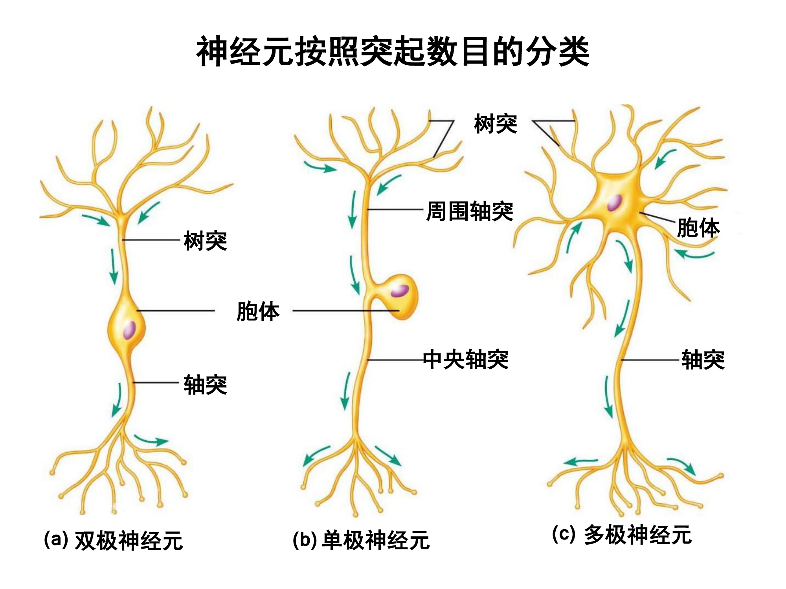

按功能可以分为**感觉神经元** $\to$（中间神经元）$\to$ **运动神经元**，顺序也正是完成反射过程途径神经元的顺序.

### 2. 神经调节的基本方式

#### 2.1 反射与反射弧

**反射**是指在中枢神经系统参与下，机体对内、外界环境刺激所产生的规律性应答反应.

**反射弧**是反射的结构基础，包括**感受器、传入神经、神经中枢、传出神经和效应器**. 膝跳反射是二元反射，缩手反射是三元反射，因为经过的神经元数量不同.

兴奋除了在反射弧中传导，还会在脑与脊髓等中枢神经系统中传导，如从脊髓的低级中枢传导到大脑皮层.

反射活动需要**完整的反射弧**来实现，任何环节在结构或功能上受损，反射就不能完成.

#### 2.2 反射的类型

反射分为非条件反射与条件反射：

- **非条件反射**：生来就已经建立的先天性反射，由非条件刺激引发；
- **条件反射**：出生以后个体在生活中通过学习或训练逐渐形成的后天性反射，由条件刺激引发.

条件反射是可以改变和重建的. 条件反射建立之后，如果反复应用条件刺激而不给予非条件刺激强化，条件反射就会逐渐减弱，最后完全不出现，称为**条件反射的消退**. 条件反射的消退并不是条件反射的丧失，而是从原先**引起兴奋（有唾液分泌）的条件反射转化为引起抑制（无唾液分泌）的条件反射**.

#### 2.3 巴甫洛夫的狗实验

条件反射是在后天生活过程中获得的，具有高度的适应性，对动物机体的生存和活动有重大意义. 巴甫洛夫（Pavlov） 的狗实验分为四个阶段，如表所示：

| 阶段 | 刺激条件 / 操作 | 反应 / 结果 |
| --- | --- | --- |
| **第一阶段** | 非条件刺激（食物） | 非条件反射（唾液分泌） |
| **第二阶段** | 非条件刺激（食物）$+$ 无关刺激（铃声） | 非条件反射（唾液分泌） |
| **第三阶段** | 无关刺激 $\to$ 条件刺激 | 条件反射形成 |
| **第四阶段** | 条件刺激 $+$ 无非条件刺激 | 条件反射消退 |

### 3. 神经冲动的产生和传导

#### 3.1 兴奋与神经冲动

蛙的坐骨神经实验如图所示：

**兴奋**指感受器受到刺激后，由静止转入活跃状态的过程.

结论：兴奋是以电信号的形式沿着神经纤维传导的，这种电信号也叫做**神经冲动**.

#### 3.2 静息电位

在未受到刺激时，神经纤维处于静息状态. 细胞膜内外两侧存在一个电位差，叫做**静息电位**，又称跨膜静息电位、膜电位.

静息电位都表现为膜内比膜外电位低，即膜内带负电而膜外带正电. 这种**内负外正**的状态，称为**极化状态**.

记膜外电位为 $0$，则哺乳动物的神经细胞的静息电位为 $-70\,\text{mV}$（即膜内比膜外电位低 $70\,\text{mV}$），骨骼肌细胞为 $-90\,\text{mV}$，人的红细胞为 $-10\,\text{mV}$.

> **说明**：细胞膜内 $\text{K}^+$ 的浓度高，细胞膜外 $\text{Na}^+$ 的浓度高，钠钾泵作为主动运输实现了 $\text{K}^+$ 的内流与 $\text{Na}^+$ 的外流.

正常时细胞内的 $\text{K}^+$ 浓度和有机负离子 $\text{A}^-$ 浓度比膜外高，而细胞外的 $\text{Na}^+$ 浓度和 $\text{Cl}^-$ 浓度比膜内高. $\text{K}^+$ 和 $\text{A}^-$ 有向膜外扩散的趋势，而 $\text{Na}^+$ 和 $\text{Cl}^-$ 有向膜内扩散的趋势. 但细胞膜在安静时，对 $\text{K}^+$ 的通透性较大，对 $\text{Na}^+$ 和 $\text{Cl}^-$ 的通透性很小，而对 $\text{A}^-$ 几乎不通透.

静息电位的微观原理如图所示：

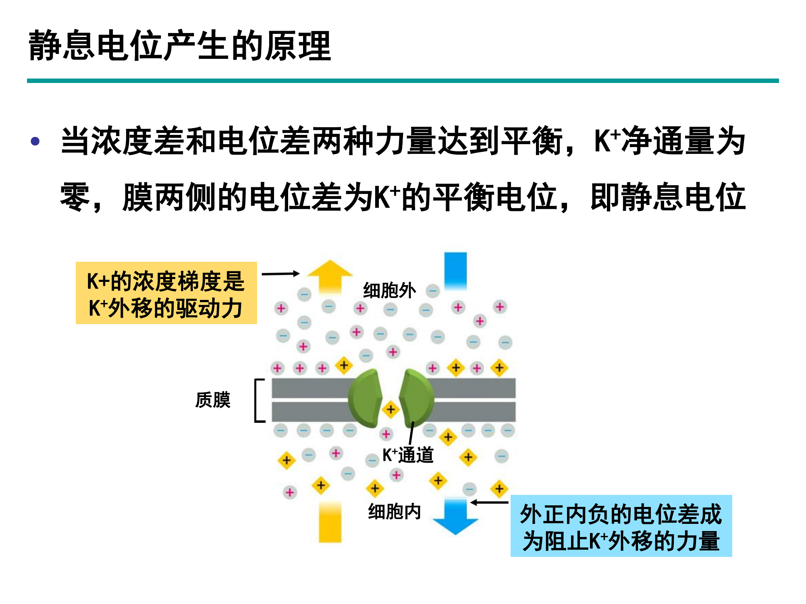

原理解释：$\text{K}^+$ **顺着浓度梯度经膜扩散到膜外**，使膜外具有较多的正电荷；有机负离子 $\text{A}^-$ 由于不能透过膜而留在膜内，使膜内具有较多的负电荷. 这就造成了膜外正、膜内负的极化状态.

由 $\text{K}^+$ 扩散到膜外造成的**外正内负的电位差，将成为阻止 $\text{K}^+$ 外移的力量**，而随着 $\text{K}^+$ 外移的增加，阻止 $\text{K}^+$ 外移的电位差也增大.

**一句话总结**：$\text{K}^+$ 的浓度梯度是 $\text{K}^+$ 外移的驱动力；外正内负的电位差成为阻止 $\text{K}^+$ 外移的力量.

#### 3.3 动作电位

动作电位是细胞受刺激时，产生的膜两侧的快速、可逆，并能扩散的电位.

动作电位的产生过程及离子通道变化如图所示：

由于刺激的不同，接受刺激可能产生复极化、去极化和超极化三种结果.

#### 3.4 兴奋在神经纤维上的传导

钠钾泵、静息电位与动作电位复极的离子机制如图所示：

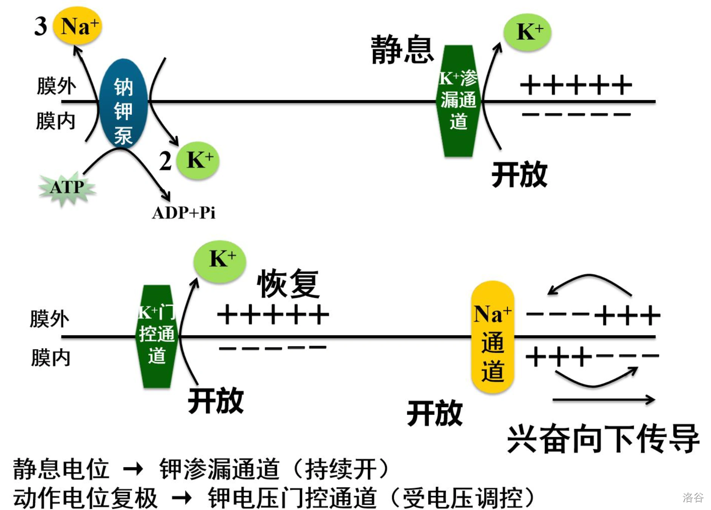

静息电位、局部电流与兴奋在神经纤维上的传导如图所示：

神经冲动在有髓神经纤维上传导的方式是跳跃式，大大加快了传导速度.

动作电位的出现非常快，每一动作电位大约只有 $1\,\text{ms}$ 的时间，故刺激不够强时，不发生动作电位，也就没有神经冲动.

**神经纤维传导兴奋的特征**：完整性、绝缘性、双向性、相对不疲劳性.

**神经纤维传导兴奋的速度**：与神经纤维的直径成正比（有髓神经纤维轴索和总直径比例 0.6 最宜），有髓 $>$ 无髓，温度在一定范围内升高可使传导速度加快.

#### 3.5 兴奋在神经元之间的传递

**突触小体**：轴突末梢经多次分支，每个小枝末端都膨大成杯状或球状小体. 突触小体里有大量线粒体，用于为**兴奋传导**或**递质分泌**提供能量.

**突触**是指一个神经元的冲动传到另一个神经元或传到另一细胞间的**相互接触的结构**. 突触小体和另一神经元的树突（一般为无脊椎动物）或细胞体的表膜（一般为脊椎动物）相联系，形成突触.

突触由**突触前膜、突触间隙、突触后膜**组成. 突触分为电突触和**化学突触**. 电突触可以是双向的，而化学突触是单向的.

化学突触的结构与传递过程如图所示：

递质的分类：按结构分为乙酰胆碱、生物胺、氨基酸、神经肽与气体；按功能分为**兴奋性神经递质**、**抑制性神经递质**和**双向神经递质**.

兴奋性神经递质主要有谷氨酸，抑制性神经递质主要有甘氨酸，双向神经递质种类很多.

**神经冲动有兴奋性的，也有抑制性的.** 神经冲动能否通过化学突触决定于这一突触释放的递质的性质和突触后膜的性质. 如果释放的递质能使突触后膜去极化，一定量的递质就可使突触后神经元去极化而兴奋，实现神经冲动的传导，这种释放兴奋性递质的突触即兴奋性突触；同理，释放抑制性递质的突触就是抑制性突触.

兴奋传递过程：轴突兴奋 $\to$ 突触小体（突触小泡）$\to$ 突触前膜 $\to$ 神经递质、突触间隙 $\to$ 突触后膜 $\to$ 神经元兴奋或抑制.

关于神经递质：

- 产生：由**内质网与高尔基体**加工而成；
- 分泌结构：突触前膜；
- 受体：突触后膜上受体；
- 作用：使后膜兴奋或抑制；
- 去向：扩散、失活、被其他细胞吞掉等.

有神经递质参与的都是化学突触，化学突触的信号经过了「电信号—化学信号—电信号」的转变过程.

### 4. 神经系统的分级调节

#### 4.1 躯体运动的分级调节

躯体运动的分级调节如图所示：

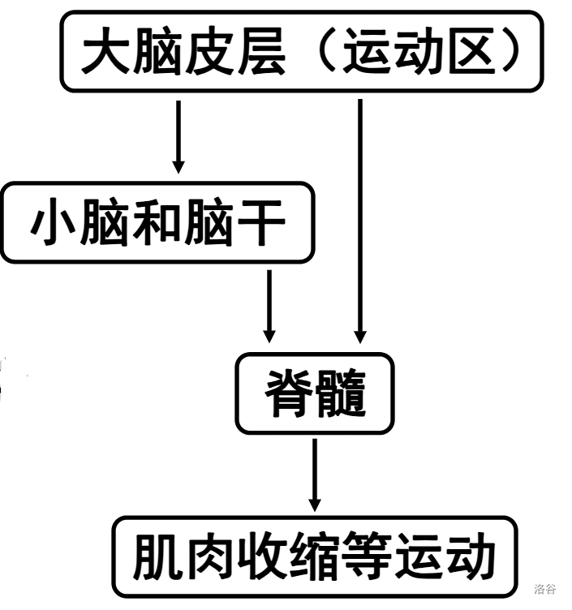

大脑中，一般感觉越精细，参与的神经元越多，面积越大.

#### 4.2 大脑皮层

神经系统中最高级的部位是**大脑皮层**.

### 5. 人脑的高级功能

#### 5.1 脑干、下丘脑、小脑与间脑

脑干的结构如图所示：

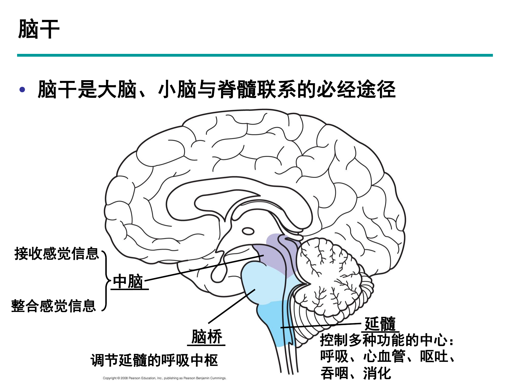

**脑干和大脑**共同控制**唤醒和睡眠**（**能睡着**）. 下丘脑还调节**昼夜节律**（**睡多久**），例如睡眠/觉醒周期.

小脑：运动、感知、认知协调、学习运动.

间脑的结构如图所示：

间脑包括丘脑和下丘脑等结构.

大脑的结构如图所示：

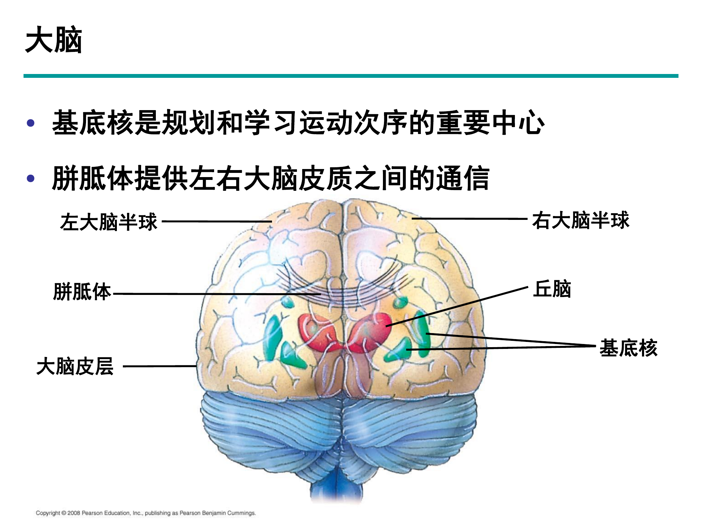

基底核是规划和学习运动次序的重要中心. 胼胝体提供左右大脑皮质之间的通信.

#### 5.2 大脑的语言功能

人类大脑皮层（左半球侧面）的言语区如图所示：

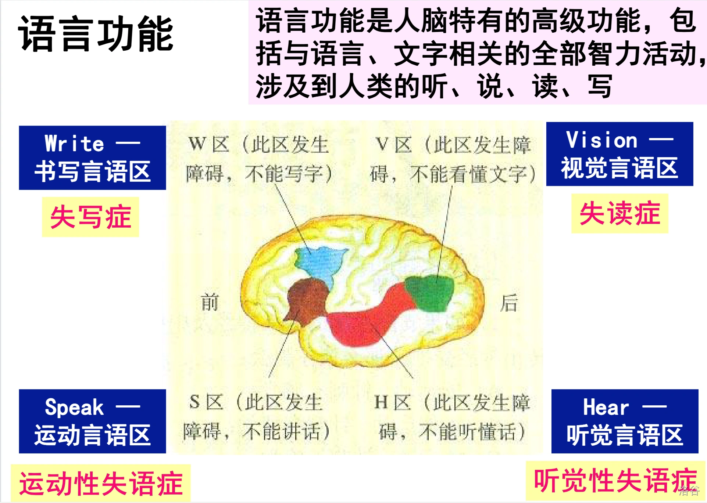

**裂脑人实验**表明，人的语言功能在左脑. 注意裂脑人实验的实验现象，眼与手对应的脑在异侧.

#### 5.3 情绪、记忆与学习

情绪：了解海马体、下丘脑的相关功能.

学习与记忆涉及神经元连接的变化；海马体参与某些记忆的形成，大脑皮层等区域也参与记忆加工. 下图为简化示意，脑区形状与大小并非精确解剖比例：

> **说明**：参考[海马体、皮层与突触可塑性](https://pubmed.ncbi.nlm.nih.gov/26525152/).

## 三、体液调节

### 1. 激素与内分泌系统

#### 1.1 激素的发现

**激素的发现**：沃泰默的实验发现盐酸不引起神经冲动；贝利斯（Bayliss）、斯特林（Starling）假设小肠黏膜分泌促胰液素促进胰液分泌（高中常见的基本唯一**不由垂体分泌的促激素**），发现了**激素调节**，促胰液素也是第一种被发现的激素.

#### 1.2 激素与激素调节

**激素的定义**：

- 由特定细胞分泌；
- 对靶细胞调控；
- 有机分子.

**激素调节**：由**内分泌器官**（或细胞）分泌的化学物质进行的调节. **它是体液调节的一种.**

#### 1.3 内分泌腺与外分泌腺

**内分泌腺**包括：下丘脑、垂体、甲状腺、胰腺**（它不是内分泌器官，是胰岛细胞）**、肾上腺和性腺.

**分泌腺**包括内分泌腺与外分泌腺两种. 外分泌腺有导管，**分泌物通过导管排出**. 内分泌腺无导管，分泌物从毛细血管进入血液循环.

#### 1.4 激素的分类

激素的分类如图所示：

**记忆**：含氮类的氨基酸类是促进体温升高的那几个激素.

### 2. 激素调节的过程

#### 2.1 血糖平衡的调节

血糖平衡的调节分为激素调节和神经调节两个方面. 影响血糖的因素有**食物糖、肝糖原与脂肪等非糖物质**等. **食物糖消化吸收为血糖，血糖通过氧化分解为 $\text{CO}_2$、$\text{H}_2\text{O}$ 与能量；肝糖原分解为血糖，血糖也可以合成肝糖原、肌糖原；脂肪等非糖物质可以转化为血糖，血糖也可以转化为脂肪与某些氨基酸.**

血糖的激素调节及胰岛细胞的分类如图所示：

胰岛素与胰高血糖素参与血糖浓度的调节.

胰岛中的不同细胞分泌不同的激素.

血糖的神经调节如图所示：

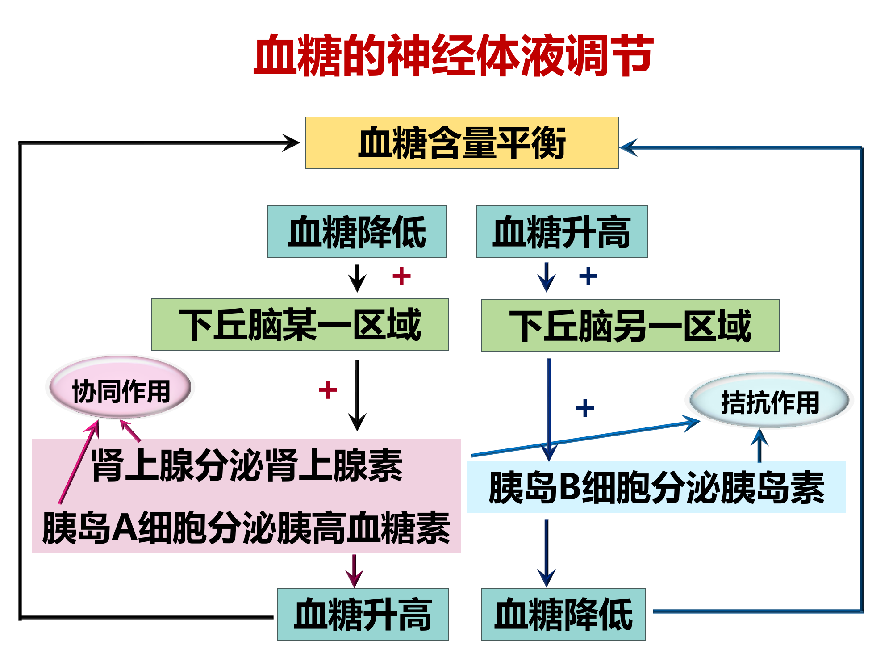

神经调节通过影响相关器官和激素分泌参与血糖平衡.

#### 2.2 协同作用与拮抗作用

**协同作用**与**拮抗作用**：第一个表示两种激素的功能相同，第二个表示两种激素的功能相反.

#### 2.3 反馈调节

激素调节的**基本调节机制是反馈调节**：系统工作反过来调控系统工作的调节方式. 反馈调节可分为促进原工作的**正反馈**（血液凝固，分娩）与抑制原工作的**负反馈**（血压，血糖）.

#### 2.4 甲状腺激素

**甲状腺激素**：促进**生物的个体发育尤其是神经系统的发育**，提高**神经系统的兴奋性**，**加速体内物质氧化分解**.

感知寒冷并反射的过程：

- 人体的温度感受器：可以分为冷觉感受器与温觉感受器两种，分布在皮肤、黏膜和内脏器官内. 下丘脑是调节体温的中枢；
- 甲状腺激素分泌调节过程如下图所示；

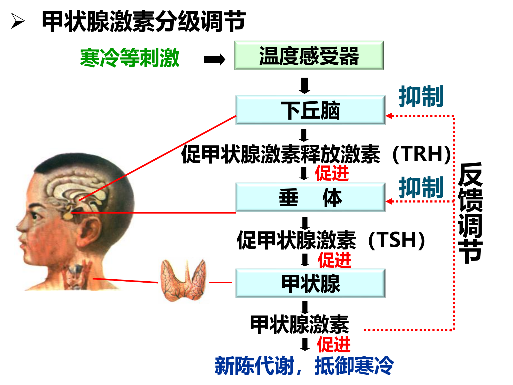

- 甲状腺激素分泌异常引起的疾病：幼年时缺乏会得**呆小症**，成年时分泌过少引起**甲状腺功能低下**、过多引起**甲亢**，食物中缺碘引起**地方性甲状腺肿**.

#### 2.5 生长激素与性激素

**生长激素**：

- 由垂体分泌；
- 作用：促进生长发育，尤其是长骨的伸长；
- 分泌异常引起的疾病：幼年时缺乏会得**侏儒症**、分泌过多引起**巨人症**，成年时分泌过多引起**肢端肥大症**.

**性激素**：

- 由性腺分泌；
- 作用：促进生殖器官生长发育，保持第二性征.

#### 2.6 激素调节的特点

**总结**：**激素调节的特点**：**由体液进行运输，作用于靶细胞和靶器官，作为信使传递信息，微量和高效.**

### 3. 体液调节与神经调节的关系

#### 3.1 神经调节与激素调节的协同

> **题**：写出神经系统的结构与功能单位、神经调节的基本方式、反射的结构基础、兴奋沿神经纤维和在神经元之间传递的方式，以及激素调节的基本机制.
>
> **解**：神经元是神经系统的结构与功能单位，反射是神经调节的基本方式，反射弧是反射的结构基础. 兴奋以电信号沿神经纤维传导，神经元之间通常通过化学突触传递信号. 反馈调节是激素调节的基本机制.

体温调节和水盐平衡都涉及神经调节与激素调节的协同作用.

#### 3.2 体温调节

- 产热量 $=$ 散热量时达到平衡，热量来源主要是**肝脏（安静）与骨骼肌（运动）**；热量散失主要通过（热传导、热辐射、热对流）与汗液、毛细血管、呼吸、排尿、排便等方式实现；
- 常见的对寒冷的反应有：血管收缩（动脉内血液流速增加）、几乎不排汗、立毛肌收缩（鸡皮疙瘩）、搓手（促进骨骼肌收缩）；
- 常见的对炎热的反应有：血管舒张、大量排汗、立毛肌舒张、器官代谢减弱等；
- **人体的体温在一定范围内波动是有益的**，比如发烧时温度偏高，而麻醉时温度偏低；
- **人体的调节体温能力是有限的**，如中暑、冻疮.

#### 3.3 水盐平衡

**（1）肾脏与泌尿系统**：泌尿系统由肾脏、输尿管、膀胱和尿道组成，其整体结构及肾单位结构如图所示.

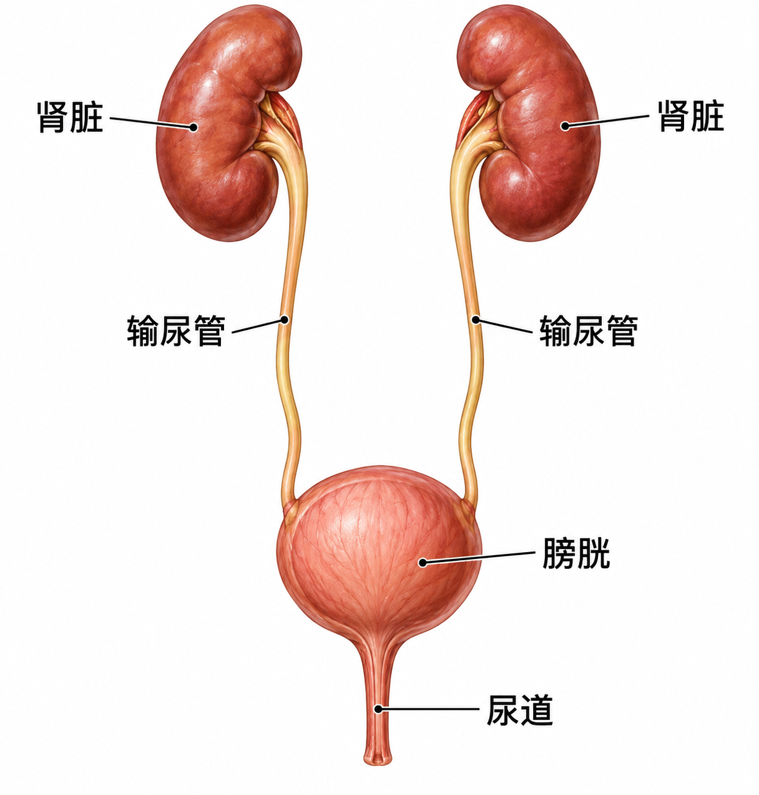

> **说明**：参考[美国国家糖尿病、消化及肾病研究所：泌尿系统](https://www.niddk.nih.gov/health-information/urologic-diseases/urinary-tract-how-it-works).

肾单位包括肾小体和肾小管，是肾脏的结构与功能单位.

**（2）水平衡**：水平衡的调节如图所示：

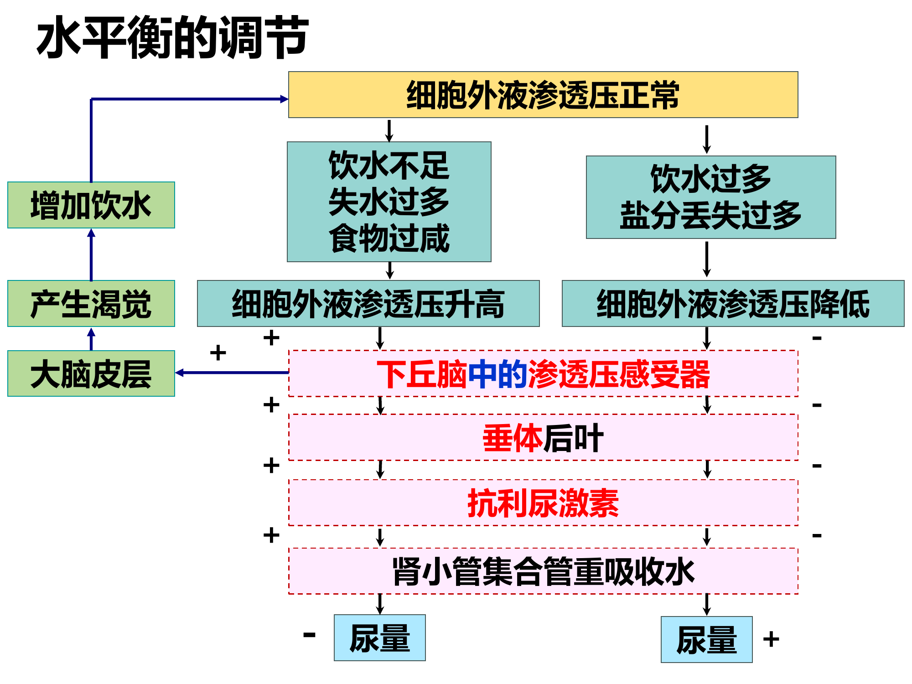

水平衡的调节涉及下丘脑、垂体与肾脏.

**（3）盐平衡**：水、钠盐与钾盐平衡的来源、排出与调节如表所示：

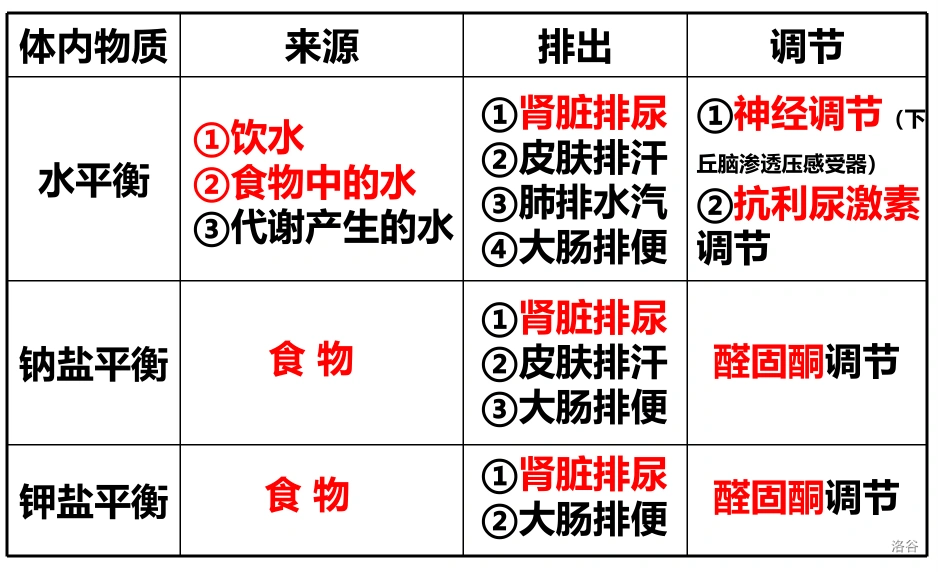

醛固酮分泌的调节过程如图所示：

相关激素：

- **抗利尿激素（血管加压素）**：由下丘脑合成，由神经垂体释放，功能是增加肾小管和集合管对水的通透性（因为有水的通道蛋白），促进水的重吸收，最后**尿量减少、尿液浓缩**；
- **醛固酮（肾上腺皮质分泌）**：**促进保钠、保水、排钾**.

调节的盐的类型：

- **钠盐**：多吃多排、少吃少排、不吃不排，细胞外液比细胞内液 $\text{Na}^+$ 多，由小肠吸收. 高温、剧烈运动、患病时会消耗 $\text{Na}^+$；缺少 $\text{Na}^+$ 会导致血压降低、心率升高、四肢发冷、外液渗透压降低. 可以补充生理盐水补充 $\text{Na}^+$；
- **钾盐**：多吃多排、少吃少排、不吃也排，细胞内液比细胞外液 $\text{K}^+$ 多，由小肠吸收. 血钾是重要的临床指标，影响细胞内液渗透压与心肌舒张；缺少 $\text{K}^+$ 可能引起心律失常.

## 四、免疫调节

### 1. 免疫系统的组成和功能

#### 1.1 免疫与免疫系统

**免疫**是机体识别和排除病原体，保护机体不受外来侵害的特性.

#### 1.2 免疫器官

免疫器官主要有**骨髓、胸腺、扁桃体、脾脏、淋巴结**. 骨髓中有红骨髓（随年龄增长会逐渐转化为黄骨髓与红骨髓各占一半，黄骨髓只是脂肪组织），具有造血功能，也是淋巴细胞初期生长的场所；脾脏能清除衰老的血细胞；胸腺和扁桃体是部分淋巴细胞最终发育成熟的场所；淋巴结是淋巴细胞集中的地方，遍布颈部、腋窝、腹股沟等位置，能够过滤淋巴，清除入侵物.

#### 1.3 免疫细胞

免疫细胞的分类如图所示：

单核细胞主要包括**树突细胞**与**巨噬细胞**. 树突细胞的功能主要是吞噬和呈递抗原的功能；巨噬细胞（**不等于吞噬细胞，巨噬细胞是具有吞噬功能的细胞——吞噬细胞的一种**）.

淋巴细胞包括**最终从胸腺发育成熟的 T 淋巴细胞和从骨髓发育成熟的 B 淋巴细胞**. **所有 T 细胞表面均含有 T 细胞受体（TCR）**，TCR 具有特异性，可识别抗原；同时，**CD（簇分化抗原）分子**也与 T 细胞的性质相关，**大多数 T 细胞也是通过 CD4 和 CD8 两种类型的 CD 分子进行区分的**.

> **说明**：T 细胞按 CD 分子可分为两类：
>
> - CD4⁺ T 细胞：除 TCR 和 CD3 外，在其表面含有 CD4 分化抗原的 T 细胞；
> - CD8⁺ T 细胞：除 TCR 和 CD3 外，在其表面含有 CD8 分化抗原.
>
> 没有一种成熟的 T 细胞同时含有 CD4 和 CD8.

T 淋巴细胞主要包括自然杀伤 T 细胞、**细胞毒性 T 细胞、辅助性 T 细胞**和调节性 T 细胞. 自然杀伤 T 细胞是同时具有 TCR 和自然杀伤细胞的标志物的细胞，属于「跨界细胞」；**细胞毒性 T 细胞是 CD8⁺ T 细胞，是产生细胞免疫的主要效应细胞，也是最主要的 T 细胞；辅助性 T 细胞是 CD4⁺ T 细胞，能协助 T 细胞或 B 细胞识别抗原，引起和增强免疫应答，激活其他细胞**；调节性 T 细胞能够抑制免疫过度，维持免疫耐受.

B 淋巴细胞主要包括**浆细胞和记忆性 B 细胞**（和 T 细胞一样，B 细胞表面也有抗原受体）. 浆细胞能够**合成与分泌抗体**（免疫球蛋白抗体）；记忆性 B 细胞能够参与淋巴系统的再循环，不同的记忆性 B 细胞表面的受体有所不同，因为其识别的抗原分子不一样.

#### 1.4 抗原与免疫活性物质

**抗原**是能够引起特异性反应的蛋白质或多糖的大分子. 常见的抗原有细菌、病毒、癌细胞、花粉等. 人体吞噬、处理并呈递抗原的过程是通过**抗原呈递细胞**完成的，**抗原呈递细胞只能呈递抗原给 T 细胞**，而不是 B 细胞.

**免疫活性物质**包括抗体、溶菌酶与细胞因子. 抗体主要分布在血浆中，也分布在淋巴与外分泌液中，起到与抗原结合的作用；溶菌酶能够溶解细菌的细胞壁以杀死细胞；细胞因子是分子较小的「信使」，白细胞介素、干扰素、肿瘤坏死因子是主要的细胞因子.

常见的抗体包括 IgM、IgG、IgA、IgE、IgD，五类抗体的分布特征与功能如表所示：

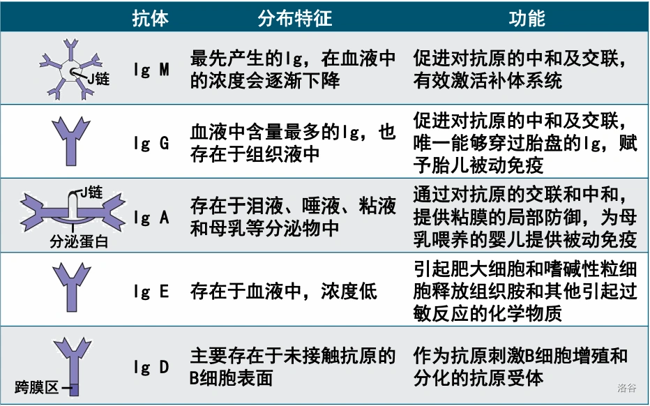

#### 1.5 人体的三道免疫防线

人体的三道免疫防线如图所示：

**屏障防御**主要包括皮肤和黏膜，部分溶菌酶；

**内部防御**主要包括部分溶菌酶、吞噬作用、炎症反应、补体、干扰素、温度反应等. 溶菌酶的工作机制是溶解细胞壁；白细胞和吞噬细胞能够吞噬细菌；身体受到损伤之后血管的通透性变化导致炎症水肿；补体蛋白通过识别抗原与抗体的复合物溶解细胞膜，促进吞噬细胞的吞噬和释放组织胺以促进炎症反应；干扰素是细胞在受到攻击之后向其他细胞释放的信号，能够促进抗病毒蛋白的合成；巨噬细胞与入侵的微生物相遇能够释放白细胞介素 1 的细胞因子，能够提高人体温度，促进吞噬作用.

**特异性免疫**主要包括细胞免疫与体液免疫两个方面.

**免疫系统的功能**：免疫防御、免疫自稳、免疫监视.

### 2. 特异性免疫

#### 2.1 淋巴细胞的识别与主要组织相容性复合体

淋巴细胞通过识别人体的 MHC（主要组织相容性复合体）判断是否为病毒（先考虑抗原中的蛋白质类，多糖类抗原一般可溶，不需要 MHC）.

人的 MHC 称为人白细胞抗原 HLA. HLA 可以分为两类，MHC-I 和 MHC-II. 其中 MHC-I 位于所有有核细胞的表面上（**包括抗原呈递细胞**），MHC-II 位于抗原呈递细胞的表面上. MHC-I 能够被 CD8⁺ T 识别，也就是说 MHC-I 能够激活细胞毒性 T 细胞；MHC-II 能够被 CD4⁺ T 识别，也就是说 MHC-II 能够激活辅助性 T 细胞.

MHC 的结构都是抗原在细胞外，MHC-II 可以对加工后的抗原肽呈现在细胞外. 细胞能够吞入抗原并利用溶酶体拆解抗原，并且最终让抗原肽与 MHC-II 结合并放到细胞表面.

#### 2.2 特异性免疫的三个阶段

特异性免疫的过程包括**感应阶段、反应阶段、效应阶段**. 感应阶段能够识别并处理抗原，反应阶段能够使淋巴细胞增殖，效应阶段是效应细胞和记忆细胞发挥功能.

> **注意**：T 细胞也有其对应的记忆细胞.

感应阶段，对于抗原获得的信息，抗原呈递细胞只能把信息呈递给 T 细胞，而进一步的，辅助 T 细胞能够把信息传递给 B 淋巴细胞.

反应阶段，淋巴细胞接受抗原信息后分化出现淋巴母细胞、浆母细胞与记忆细胞. 淋巴母细胞最终成为效应 T 细胞，浆母细胞最终成为浆细胞，效应 T 细胞和浆母细胞是终末细胞，不再增殖，寿命短；记忆细胞体积小，寿命长，使机体能够长期对抗某种抗原.

效应阶段，效应 T 细胞执行细胞免疫作用，浆细胞合成并分泌抗体.

人体的特异性免疫包括细胞免疫与体液免疫两个阶段.

#### 2.3 细胞免疫

**T 细胞是细胞免疫的主要细胞**，整个细胞免疫过程大致如下：

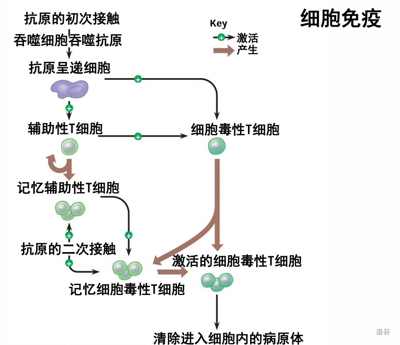

抗原被细胞识别的过程包含两个阶段：抗原和 MHC 结合；T 细胞识别抗原并结合.

免疫过程主要有：

- 辅助 T 细胞识别抗原；
- 辅助 T 细胞提供信息给细胞毒性 T 细胞或细胞毒性 T 细胞与抗原结合；
- 细胞毒性 T 细胞识别靶细胞；
- 分泌穿孔素与颗粒酶；
- 杀死细胞，内容物流出.

杀死细胞的方式主要是：穿孔素与颗粒酶，或直接让细胞凋亡.

杀死细胞之后，细胞的内容物流出到体液中，进入体液免疫.

#### 2.4 体液免疫

**B 细胞是体液免疫的主要细胞**，整个体液免疫过程大致如下：

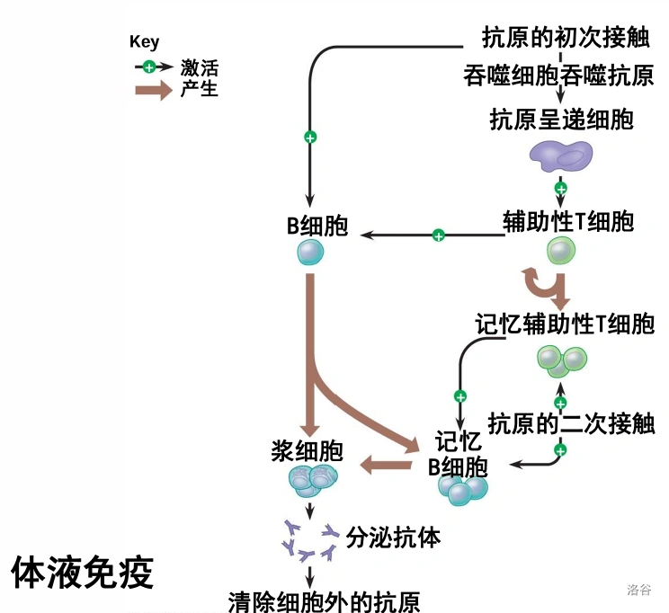

抗体与抗原形成特异结合，再通过下列反应消灭抗原：

**（1）中和反应**：抗体结合抗原以便吞噬细胞吞噬，是**多个抗体结合 1 个抗原**；

**（2）聚集反应**：抗体是双价的，可以使抗原聚集，以便吞噬，是**多个抗体结合多个抗原**；

**（3）沉淀反应**：抗体结合后，使可溶性抗原大分子沉淀，以便吞噬；

**（4）激活补体**：激活补体后使靶细胞裂解.

#### 2.5 初次免疫应答与二次免疫应答

体液免疫应答一般包括**初次免疫应答与二次免疫应答**. 初次免疫应答强度弱，反应慢；二次免疫应答强度大，反应快.

特异性免疫的总流程如图所示：

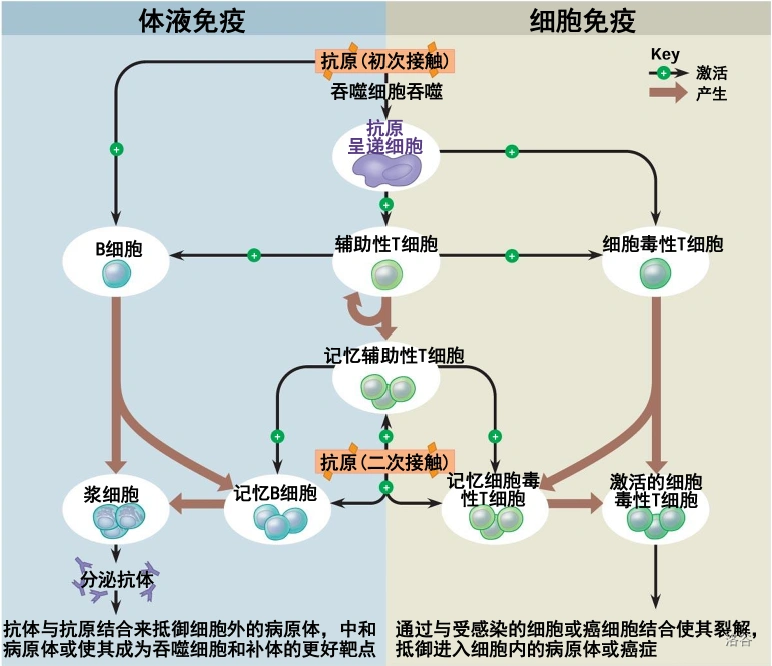

体液免疫和细胞免疫分别以 B 细胞和 T 细胞为主要细胞.

### 3. 免疫失调

#### 3.1 过敏反应

**过敏反应**的特点：

- 发作迅速，反应强烈，消退较快；
- 一般不会破坏组织细胞；
- 有明显的遗传倾向和个体差异.

初次接触过敏原致敏，再次接触过敏原会导致过敏. 过敏反应的发生流程如图所示：

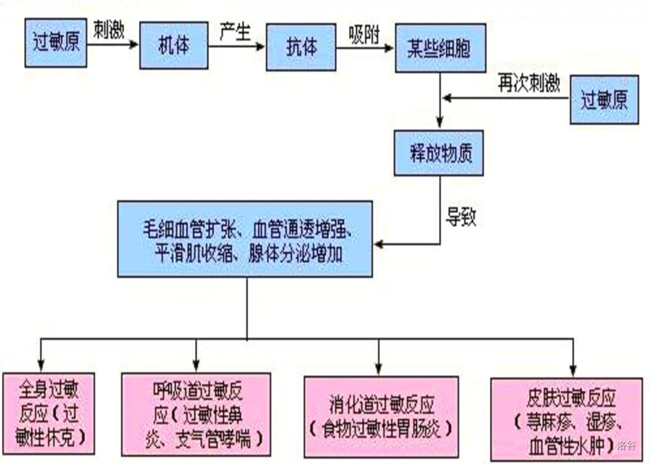

过敏反应的原因是组织胺. 组胺能够引起毛细血管扩张、血管壁通透性增强、平滑肌收缩和腺体分泌增多等.

#### 3.2 自身免疫病

**自身免疫病**：免疫系统过于灵敏、反应过度、「敌我不分」，将自身物质当作外来异物进行攻击.

如：类风湿性关节炎、风湿性心脏病、系统性红斑狼疮.

#### 3.3 免疫缺陷病与艾滋病

**免疫缺陷病**：指由机体免疫功能不足或缺乏而引起的疾病.

分为先天性免疫缺陷病与获得性免疫缺陷病，大多数是获得性免疫缺陷病.

**艾滋病**（HIV 病毒引起）：

- 发病原理：HIV 病毒入侵免疫细胞并逆转录复制 DNA，通过整合宿主 DNA，完成复制过程，并通过翻译组合蛋白质外壳，产生新的病毒，通过破坏细胞组织、膜结构，最终大量释放入血；
- 艾滋病的传播途径：性传播、血液传播、母婴传播.

### 4. 免疫学的应用

#### 4.1 疫苗

**疫苗**是指用各类病原微生物制作的用于预防接种的生物制品，通常是用灭活或减毒的病原体制成.

疫苗分为减毒活疫苗和灭活疫苗. 减毒活疫苗免疫效果好，作用时间长，但不易保存，有回复变异的风险；灭活疫苗毒性低，但免疫效果弱，作用时间短. 常见的减毒活疫苗有脊髓灰质炎糖丸；裂解疫苗也是灭活疫苗的一种.

#### 4.2 疾病检测

通过查是否有特异性抗体（如激素与病原体抗原或抗体）实现.

#### 4.3 器官移植

使用免疫抑制剂. 移植的器官可以用干细胞培养（得到诱导多能干细胞）.

## 五、植物生命活动的调节

### 1. 植物生长素

#### 1.1 植物的应激性

植物能够感受环境刺激并作出反应，这种特性称为**应激性**. 植物的**感性运动**与刺激的方向无关，**向性运动**的方向取决于刺激的方向. 向光性和向地性都是向性运动.

#### 1.2 生长素的发现

**胚芽鞘**在种子萌发时保护向上生长的胚芽. 研究者通过改变胚芽鞘尖端受到的刺激和尖端与下部的连接方式，研究向光弯曲的原因.

**（1）达尔文（Darwin）的向光性实验**：在单侧光下，切去尖端的胚芽鞘停止生长，遮住尖端的胚芽鞘直立生长. 罩住尖端的帽子透光时，或只遮住尖端下方时，胚芽鞘仍向光弯曲. 图中比较了这四种处理.

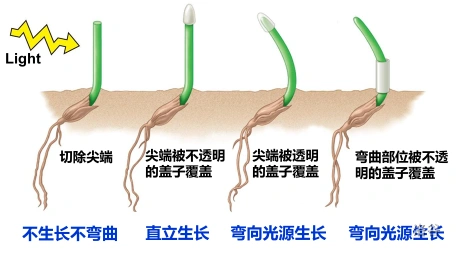

实验表明，胚芽鞘尖端感受单侧光的刺激，弯曲发生在尖端下方.

**（2）鲍森·詹森（Boysen-Jensen）的隔片实验**：在尖端与下部之间分别放入琼脂片和云母片，并用单侧光照射. 两种处理的结果如图所示.

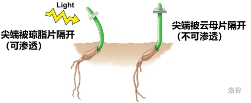

放入琼脂片的胚芽鞘仍向光弯曲，放入云母片的胚芽鞘直立. 这表明尖端产生的刺激可以透过琼脂片向下传递.

**（3）拜尔（Paál）的尖端偏置实验**：在黑暗中，把切下的尖端放在胚芽鞘切面的一侧，胚芽鞘向放置尖端的对侧弯曲. 实验表明，尖端传下的刺激在两侧分布不均，可以使胚芽鞘弯曲.

**（4）温特（Went）的琼脂块实验**：先让切下的尖端与琼脂块接触，再在黑暗中把琼脂块放到去尖端的胚芽鞘上. 图中比较了空白琼脂块、居中放置和偏置放置的结果.

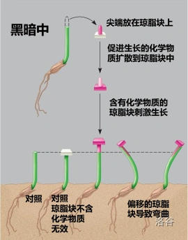

空白琼脂块未能恢复生长，接触过尖端的琼脂块居中放置时使胚芽鞘直立生长，偏置时使胚芽鞘向放置琼脂块的对侧弯曲. 实验表明，尖端产生的促生长物质能进入琼脂，这类物质称为**生长素**.

> **说明**：实验文献见[达尔文原著](https://darwin-online.org.uk/converted/published/1880_Movement_F1325/1880_Movement_F1324.html)、[鲍森·詹森论文](https://doi.org/10.1111/j.1438-8677.1913.tb06990.x)和[温特论文](https://natuurtijdschriften.nl/pub/552385/).

#### 1.3 生长素与向光性

1934 年，科戈（Kögl）等人报道了从人尿中分离的**吲哚乙酸**（IAA）. **苯乙酸**（PAA）和**吲哚丁酸**（IBA）也具有生长素效应. [科戈等人的论文](https://doi.org/10.1515/bchm2.1934.228.1-2.90)

单侧光照使胚芽鞘背光侧积累较多的生长素. 背光侧的细胞比向光侧伸长得快，胚芽鞘因两侧伸长速度不同而向光弯曲.

#### 1.4 生长素的合成、分布与运输

生长素主要在生长旺盛的部位合成，包括根尖、茎尖、芽尖等顶端分生组织、幼叶和发育中的种子. 生长素广泛而不均匀地分布于植物体中，生长旺盛的部位和发育中的果实、种子中含量较高.

生长素的**极性运输**是从植物形态学上端向形态学下端的运输. 在单侧光或重力等刺激下，生长素还可以发生横向运输，使两侧分布不均，进而引起弯曲生长. 图中展示了生长素的运输方向.

生长素的极性运输需要消耗能量，缺氧会影响其运输.

> **题**：切去玉米胚芽鞘顶端，在形态学上端放含生长素的琼脂块，下端放不含生长素的琼脂块. 一段时间后，下端琼脂块中检测到生长素. 能否据此断定生长素只能从形态学上端运向下端？如何改进实验？
>
> **解**：该实验表明生长素可以从形态学上端运向下端. 可增设对照，分别改变胚芽鞘的放置方向和供体琼脂块所接触的形态学端，比较受体琼脂块中的生长素，以检验运输方向和重力的影响.

> **题**：判断图中四种处理下胚芽鞘的生长情况.
>
> 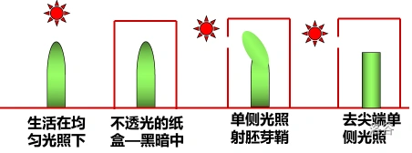
>
> **解**：依次为直立生长、直立生长、弯向光源生长、不生长也不弯曲.

> **题**：根据图中的胚芽鞘实验选择答案.
>
> 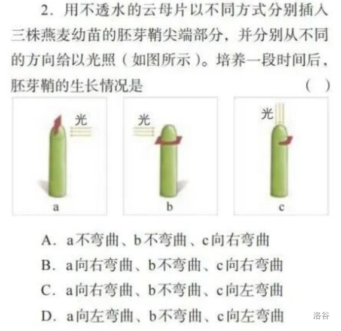
>
> **解**：选 A.

#### 1.5 生长素的生理作用

生长素具有促进植物生长、促进生根、促进果实发育和防止落花落果等作用. 在细胞水平上，生长素影响细胞的伸长、分裂和分化；在器官水平上，它影响器官的生长、成熟和衰老.

生长素的作用具有**两重性**：不同浓度和不同分布条件下，它既可促进生长，也可抑制生长；既可促进发芽，也可抑制发芽；既可防止落花落果，也可疏花疏果.

不同器官对生长素的敏感程度不同，根、芽、茎依次降低；幼嫩细胞比衰老细胞敏感. 图中显示了不同器官对生长素浓度的反应.

双子叶植物通常比单子叶植物对生长素敏感. 图中比较了两类植物的结构特征，小麦、水稻和玉米属于单子叶植物.

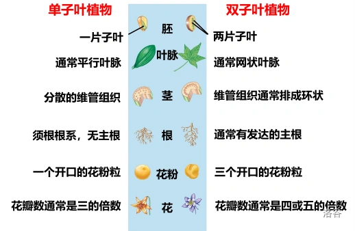

**顶端优势**是顶芽优先生长、侧芽生长受抑制的现象. 顶芽产生的生长素向下运输，在侧芽附近积累；侧芽对生长素浓度较敏感，生长受到抑制. 棉花打顶和茶园剪枝利用修剪解除顶端优势.

水平放置的幼苗受到重力刺激后，生长素分布改变. 根和茎对生长素的敏感程度不同，根向地生长，茎背地生长，如图所示.

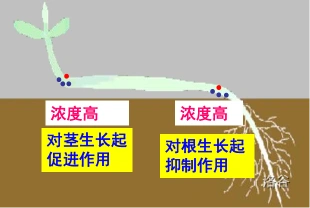

在失重的宇宙飞船中，水平放置的幼苗不会产生由重力引起的向地性和背地性弯曲.

### 2. 其他植物激素

**植物激素**是植物体内产生、能从产生部位运送到作用部位、对植物生长发育有显著影响的微量有机物. 除生长素外，还有赤霉素、细胞分裂素、脱落酸和乙烯等.

#### 2.1 赤霉素

水稻感染赤霉菌后可能发生恶苗病，表现为茎过度伸长而不结穗. 研究发现，造成这一现象的物质是**赤霉素**.

赤霉素主要在未成熟的种子、幼芽和幼根中合成，促进茎的细胞伸长、植株增高、种子萌发和果实发育，并可打破块茎休眠.

| 比较项目 | 生长素 | 赤霉素 |
| --- | --- | --- |
| 主要合成部位 | 顶端分生组织、幼叶和发育中的种子 | 未成熟的种子、幼芽、幼根 |
| 主要作用 | 促进细胞伸长和生根，维持顶端优势，促进果实发育 | 促进茎伸长和种子萌发，打破休眠，促进果实发育 |
| 作用过程 | 促进细胞壁酸化，增大细胞壁的可塑性 | 调节基因表达，促进细胞伸长和种子贮藏物质的动员 |

生长素促进细胞伸长的过程如图所示，细胞壁酸化有利于细胞伸长.

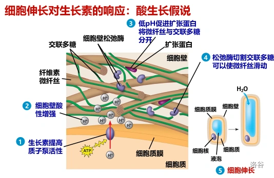

赤霉素可诱导谷物种子中淀粉酶的形成，促进贮藏养分的动员，过程如图所示.

**离区**是使叶、花、果实等器官脱离母株的组织；**单性结实**是子房未经受精发育成果实的现象.

#### 2.2 细胞分裂素

**细胞分裂素**主要在根尖合成，促进细胞分裂、芽的分化与侧枝发育，促进叶绿素合成，并延缓离体叶片衰老. 生长素与细胞分裂素共同调节植物生长，如图所示.

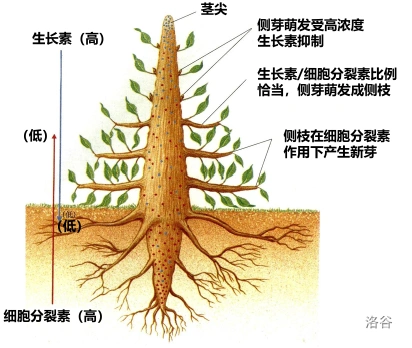

在植物组织培养中，生长素与细胞分裂素的相对浓度影响器官分化：比值较高时有利于根的分化，比值较低时有利于芽的分化. 离体植物器官、组织或细胞先经脱分化形成愈伤组织，再经再分化形成根、芽等器官，进而形成新的植株.

#### 2.3 脱落酸与乙烯

**脱落酸**主要在根冠、萎蔫叶片等部位合成，较多分布于将要脱落的器官和组织. 它抑制细胞分裂，促进气孔关闭、叶和果实的衰老与脱落，并维持种子休眠、抑制萌发.

**乙烯**在植物体各部位合成，促进果实成熟、某些植物雌花形成以及叶、花和果实脱落. 植物生长素和乙烯的平衡变化参与调节叶片脱落.

> **题**：香蕉催熟、扦插枝条生根、抑制马铃薯发芽、使矮茎花卉长高和植物组织培养，分别可使用哪些植物激素或类似物？
>
> **解**：依次可使用乙烯、适宜浓度的生长素或其类似物、脱落酸、赤霉素，以及生长素和细胞分裂素.

#### 2.4 植物激素的相互作用

植物的生长发育受多种激素共同调节，激素之间存在协同作用和拮抗作用. 植物生长发育是基因组在一定时间和空间上程序性表达的结果，基因表达也受环境因素影响.

图中列出了植物激素之间的协同作用和拮抗作用.

### 3. 植物生长调节剂的应用

**植物生长调节剂**是人工合成的、对植物生长发育有调节作用的化学物质，具有原料广泛、容易合成和效果稳定等特点. 常见应用包括用赤霉素类调节剂打破种子休眠、促进茎生长，用 $\alpha$-萘乙酸（NAA）促进生根或调节花果脱落，用乙烯利催熟果实，以及用矮壮素抑制植株过度生长.

#### 3.1 促进扦插枝条生根

用适宜浓度的生长素类似物溶液浸泡插枝形态学下端，可以促进生根. 生长素类似物包括 $\alpha$-萘乙酸和 2,4-二氯苯氧乙酸（2,4-D）.

植物器官和组织具有**极性**. 扦插枝条通常在形态学下端和节处较易形成不定根，图中比较了不同位置的生根情况.

图示条件相同时，C 处先长出根.

#### 3.2 除草与促进果实发育

2,4-D 可用作麦田、稻田的除草剂. 双子叶植物与单子叶植物对生长素的敏感程度不同，可利用适宜浓度抑制杂草生长. 2,4-D 可引起染色体变异.

用适宜浓度的生长素类似物处理未授粉的雌蕊柱头或子房，可以促进果实发育，培育无子果实. 图中展示了处理方法.

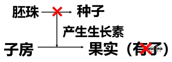

可在花蕾期去雄，对雌蕊柱头涂抹适宜浓度的生长素类似物并套袋. 由此形成的果实的染色体数目与正常果实相同. 三倍体无籽西瓜则由四倍体和二倍体杂交获得，其染色体联会紊乱，难以形成正常种子.
